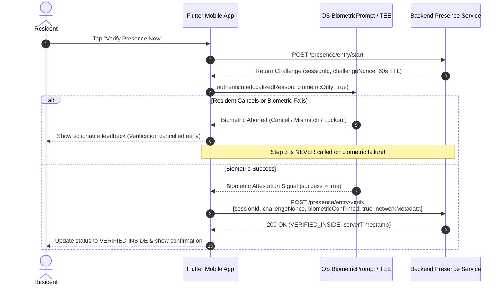

# Resident Mobile Application (Flutter)

A cross-platform Flutter application for residents of the **Smart Hostel Curfew & Multi-Factor Presence Verification System**. The app interacts exclusively with the authenticated Node.js/TypeScript backend API to verify presence, enforce hardware device binding, manage token lifecycles, and handle curfew workflows.

---

## 1. Architecture & Design Principles

The application is structured using a **Feature-Driven Architecture**:

```plaintext
apps/mobile/
├── lib/
│   ├── core/                           # Cross-cutting foundational modules
│   │   ├── biometrics/                 # OS Biometric abstraction, results & mock provider
│   │   │   ├── biometric_result.dart   # Typed result model & status codes
│   │   │   ├── biometric_service.dart  # IBiometricService contract & LocalAuth implementation
│   │   │   └── mock_biometric_service.dart # Deterministic test mock provider
│   │   ├── constants/                  # API endpoints, storage keys, base URLs
│   │   ├── network/                    # Typed ApiClient with Bearer injection & refresh interceptor
│   │   └── storage/                    # Secure persistent storage (Keychain / Keystore)
│   ├── features/
│   │   ├── auth/                       # Login, activation, session restoration
│   │   │   ├── models/                 # User, ResidentProfile, Device, AuthSession DTOs
│   │   │   ├── presentation/           # LoginScreen, ActivateScreen
│   │   │   ├── services/               # AuthService (login, activate, logout)
│   │   │   └── state/                  # AuthNotifier (ChangeNotifier reactive state)
│   │   ├── device/                     # Hardware device fingerprinting and binding
│   │   │   ├── presentation/           # DeviceBindingScreen (forced when device is unassigned)
│   │   │   └── services/               # DeviceService (POST /auth/device/register)
│   │   ├── home/                       # Curfew dashboard & presence actions
│   │   │   └── presentation/           # HomeDashboardScreen
│   │   ├── presence/                   # Presence verification orchestration
│   │   │   ├── models/                 # PresenceVerificationResult & flow status
│   │   │   └── services/               # PresenceService (entry flow & exit)
│   │   └── profile/                    # Resident assignment & device info
│   │       └── presentation/           # ProfileScreen
│   └── main.dart                       # Entry point, dependency injection, and state routing
├── test/
│   ├── core/                           # ApiClient & BiometricService tests
│   └── features/
│       ├── auth/                       # AuthService & LoginScreen widget tests
│       ├── device/                     # DeviceService unit tests
│       ├── home/                       # HomeDashboardScreen biometric widget tests
│       └── presence/                   # PresenceService unit tests
└── pubspec.yaml                        # Dependencies and Flutter SDK configuration
```

---

## 2. Platform Biometric Authentication & Privacy Compliance

### 2.1 OS-Level Biometrics Integration (`LocalAuthentication`)
The app integrates with operating system biometric APIs:
- **Android**: Invokes Android Jetpack `BiometricPrompt` (Class 3 / Strong Biometrics: hardware-backed fingerprint, 3D facial recognition, iris scan).
- **iOS**: Invokes `LocalAuthentication` framework (`LAContext.evaluatePolicy(.deviceOwnerAuthenticationWithBiometrics)` for Touch ID / Face ID).

### 2.2 Privacy Compliance & Security Guarantees
- **Zero Raw Biometric Storage**: The mobile app **NEVER** requests, queries, accesses, processes, or stores raw biometric images, minutiae data, or biometric templates.
- **Hardware Isolation**: All biometric scanning, template comparison, and feature matching occur strictly inside the device's hardware Secure Enclave (iOS) or Trusted Execution Environment / TEE (Android).
- **Zero Network Transmission**: Biometric data never leaves the hardware security module and is **never transmitted across the network**. The backend API only receives an attestation boolean (`biometricConfirmed: true`) embedded in the cryptographic challenge-response payload.
- **Regulatory Compliance**: Designed in accordance with **GDPR Article 9** (Processing of special categories of data), Apple App Store Review Guidelines Section 5.1, and Android Compatibility Definition Document (CDD) biometric standards.

### 2.3 Resilient Handling of Biometric Edge Cases
The `IBiometricService` and `LocalAuthBiometricService` wrap platform exceptions into strongly typed `BiometricResult` instances:
- **User Cancellation**: If the resident dismisses the prompt, a polite floating notification appears. The flow aborts safely without generating error states or penalties.
- **Biometric Mismatch (Failure)**: If a fingerprint or face does not match, the resident is prompted to try again. The server verification endpoint is **never** invoked.
- **Temporary Lockout (`LockedOut`)**: If too many invalid attempts occur, the OS locks the sensor (typically for 30 seconds). The app displays an alert dialog guiding the resident to wait before retrying.
- **Permanent Lockout (`PermanentlyLockedOut`)**: After repeated lockouts, the OS permanently disables the sensor until the primary device PIN or passcode is entered. The app displays guidance for unlocking the device in OS settings.
- **Sensor Unavailable / Not Enrolled**: When the hardware sensor is absent or no biometrics are registered, actionable setup dialogs direct the resident to configure biometrics in system settings.

### 2.4 Resident Check-In Presence Sequence
The presence verification sequence follows a strict 3-step security pipeline:



---

## 3. Key Technical Highlights

### 3.1 Silent Token Refresh & Retry Interceptor
The `ApiClient` wraps an HTTP client with automatic session persistence:
1. Every request automatically injects `Authorization: Bearer <accessToken>`.
2. When the backend returns an HTTP `401 Unauthorized` with `TOKEN_EXPIRED`, the `ApiClient` intercepts the failure and initiates a background refresh call (`POST /auth/refresh`) using the securely stored refresh token.
3. If the token refresh succeeds, the new tokens are persisted to secure storage and the original failed request is transparently retried.
4. If the refresh token is invalid or revoked, local session data is cleared and the user is safely routed back to `LoginScreen`.

### 3.2 Single Active Device Enforcement
1. During authentication, if the user account is active but has no registered active device (`user.hasActiveDevice == false`), the application intercepts navigation and directs the resident directly to the `DeviceBindingScreen`.
2. The resident cannot access the `HomeDashboardScreen` until their hardware fingerprint is registered and bound on the server (`POST /auth/device/register`).
3. Attempting to register multiple active devices is prevented server-side with HTTP `409 Conflict`.

### 3.3 Resilient Error & Offline Handling
- **Network Disconnects**: Catches `SocketException` and `ClientException`, throwing typed `OfflineException` and rendering an offline banner.
- **Network Authorization Checks**: Catches HTTP `403 NETWORK_NOT_AUTHORIZED` when outside hostel Wi-Fi and presents a clear "Hostel Wi-Fi Required" modal.
- **Rate Limiting**: Parses `Retry-After` headers on HTTP `429 Too Many Requests` and notifies the user with the required wait period.
- **Pending Activation**: Accounts awaiting onboarding are recognized via `ACCOUNT_PENDING_ACTIVATION` and provided a 1-tap route to `ActivateScreen`.

---

## 4. Getting Started & Development Setup

### Prerequisites
- **Flutter SDK**: `>= 3.19.0` ([Install Flutter](https://flutter.dev/docs/get-started/install))
- **Dart SDK**: `>= 3.3.0`
- **Node.js Backend**: Running on port `4000` (`npm run dev --prefix services/api`)

### Installation
```bash
cd apps/mobile
flutter pub get
```

### Network Configuration for Local Development
The app automatically detects the platform and configures the API base URL:
- **Android Emulator**: Uses `http://10.0.2.2:4000` (maps to host `localhost:4000`).
- **iOS Simulator / Desktop / Web**: Uses `http://localhost:4000`.
- **Physical Device**: Update `baseUrl` in `lib/core/constants/api_constants.dart` with your machine's LAN IP (e.g. `http://192.168.1.15:4000`).

### Running the App
```bash
# Run on connected Android / iOS device
flutter run

# Run on Chrome for quick UI verification
flutter run -d chrome
```

---

## 5. Running Automated Tests

The mobile test suite covers unit tests for storage, networking, authentication services, device registration, biometric abstractions, presence orchestration, and widget tests for the dashboard:

```bash
cd apps/mobile
flutter test
```

### Test Suites Included
- `test/core/api_client_test.dart`: Validates Bearer token injection, automatic 401 token refresh retry, and RFC 7807 error parsing.
- `test/core/biometric_service_test.dart`: Validates `IBiometricService`, `MockBiometricService`, success, cancellation, sensor failure, temporary lockout (30s delay), and permanent lockout.
- `test/features/auth/auth_service_test.dart`: Validates credential transmission, token persistence, and logout teardown.
- `test/features/device/device_service_test.dart`: Validates hardware fingerprint registration and 409 conflict handling.
- `test/features/presence/presence_service_test.dart`: Validates presence entry sequence, pre-submission biometric abortion, and network rejection handling.
- `test/features/auth/login_screen_test.dart`: Widget test verifying field validation and loading state UI.
- `test/features/home/home_dashboard_biometrics_test.dart`: Widget tests verifying dashboard biometric prompts, status badge updates, cancellation feedback, lockout dialogs, and exit flow.
