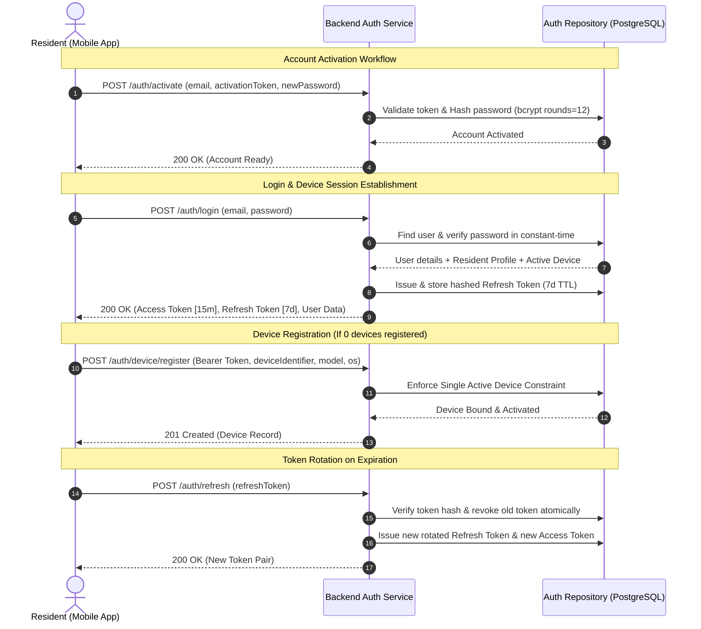
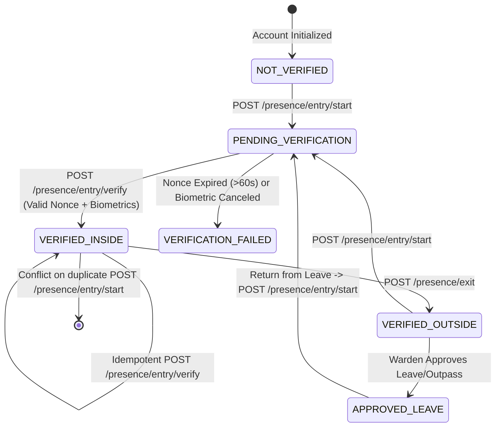
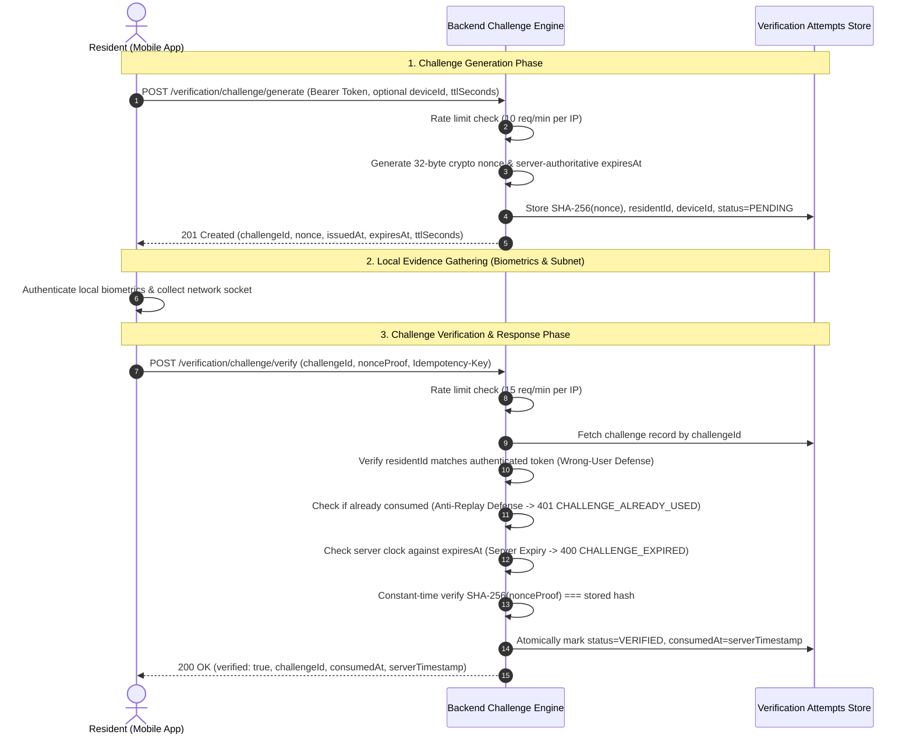

# API Specification & Authentication Architecture

## 1. Authentication Architecture & Security Model

The **Hostel Curfew & Multi-Factor Presence Verification System** implements an enterprise-grade, role-based token authentication mechanism designed to resist credential stuffing, session hijacking, replay attacks, and proxy attendance manipulation.



### Core Security Guardrails
1. **Password Hashing**: Uses `bcrypt` with cost factor 12. Login verification includes dummy hash comparison on non-existent accounts to eliminate timing side-channels and user enumeration.
2. **Access Token Lifespan**: Signed JWT access tokens have a short TTL of **15 minutes** with `HS256`.
3. **Rotating Refresh Tokens**: Stored as SHA-256 digests. Each refresh call revokes the existing refresh token and issues a new pair. If an already-consumed token is re-submitted, the session is invalidated immediately (theft detection).
4. **Hardware Device Binding**: A resident is restricted to **at most one active registered hardware device**. Attempts to register a second active device trigger HTTP `409 Conflict`.
5. **Brute-Force Rate Limiting**: Sensitive endpoints (`/auth/login`, `/auth/activate`) enforce an in-memory sliding window rate limiter (maximum 5 attempts per 15-minute window per IP) returning HTTP `429 Too Many Requests` with standard `Retry-After` headers.
6. **Strict RBAC Enforcement**: Role escalation is blocked server-side through `requireRoles(...)` middleware; UI element visibility is never treated as security.

---

## 2. Role-Based Access Control (RBAC) Matrix

| Endpoint | Permitted Roles | Notes |
| :--- | :--- | :--- |
| `POST /auth/login` | Public | Rate-limited (5 attempts / 15 min window) |
| `POST /auth/refresh` | Public (Requires valid Refresh Token) | Single-use rotation |
| `POST /auth/logout` | Public (Requires Refresh Token) | Revokes active session |
| `POST /auth/activate` | Public (Requires pre-provisioned activation token) | For new student onboarding |
| `POST /auth/device/register`| `RESIDENT` | Binds hardware device to student profile |
| `POST /presence/entry/start`| `RESIDENT` | Initiates entry check-in, issues challenge nonce |
| `POST /presence/entry/verify`| `RESIDENT` | Verifies multi-factor evidence & completes entry |
| `POST /presence/exit` | `RESIDENT` | Records resident exit |
| `GET /presence/me` | `RESIDENT` | Current presence status & recent events |
| `GET /curfew/current` | `RESIDENT`, `WARDEN`, `ADMIN`, `SUPER_ADMIN` | Today's active curfew policy and deadlines |
| `POST /admin/curfew` | `WARDEN`, `ADMIN`, `SUPER_ADMIN` | Create hostel curfew policy rule |
| `PATCH /admin/curfew/:id` | `WARDEN`, `ADMIN`, `SUPER_ADMIN` | Amend curfew time or grace window |
| `GET /admin/curfew/status` | `WARDEN`, `ADMIN`, `SUPER_ADMIN` | Live curfew roster with failure alerts & filters |
| `GET /admin/leave` | `WARDEN`, `ADMIN`, `SUPER_ADMIN` | Leave approval queue & history |
| `PATCH /admin/leave/:id` | `WARDEN`, `ADMIN`, `SUPER_ADMIN` | Adjudicate leave with mandatory reason |
| `POST /admin/presence/correct`| `WARDEN`, `ADMIN`, `SUPER_ADMIN` | Transactional presence correction + audit log |
| `GET /admin/audit` | `WARDEN`, `ADMIN`, `SUPER_ADMIN` | Query immutable audit ledger |
| `PATCH /admin/users/:id/status`| `ADMIN`, `SUPER_ADMIN`, `WARDEN` | Update account status with mandatory justification |
| `POST /admin/devices/:id/revoke`| `WARDEN`, `ADMIN`, `SUPER_ADMIN` | Revoke registered device with mandatory justification |
| `GET /admin/reports/daily-attendance`| `WARDEN`, `ADMIN`, `SUPER_ADMIN` | Daily presence report (JSON & RFC-4180 CSV) |
| `GET /admin/reports/late-returns`| `WARDEN`, `ADMIN`, `SUPER_ADMIN` | Late return report (JSON & RFC-4180 CSV) |
| `GET /admin/reports/leaves` | `WARDEN`, `ADMIN`, `SUPER_ADMIN` | Leave audit report (JSON & RFC-4180 CSV) |
| `GET /admin/reports/verification-failures`| `WARDEN`, `ADMIN`, `SUPER_ADMIN` | Security failure report (JSON & RFC-4180 CSV) |
| `GET /admin/reports/audit` | `WARDEN`, `ADMIN`, `SUPER_ADMIN` | Executive audit trail export (RFC-4180 CSV) |

---

## 3. Standard Request & Response Envelopes

### Success Envelope
```json
{
  "data": { ... },
  "message": "Human readable confirmation (optional)"
}
```

### Error Envelope (RFC 7807 Problem Details Pattern)
```json
{
  "error": {
    "code": "ERROR_CODE_STRING",
    "message": "Human readable explanation",
    "details": null
  },
  "timestamp": "2026-09-29T14:30:00.000Z"
}
```

---

## 4. Endpoint Specifications

### 4.1 `POST /auth/login`
Authenticates an active user and issues an access/refresh token pair.

**Request Body:**
```json
{
  "email": "aarav.patel@student.edu",
  "password": "SecureStudentPass!2026"
}
```

**Success Response (200 OK):**
```json
{
  "data": {
    "accessToken": "eyJhbGciOi...",
    "refreshToken": "eyJhbGciOi...",
    "expiresIn": "15m",
    "user": {
      "id": "c0000000-0000-0000-0000-000000000003",
      "name": "Aarav Patel",
      "email": "aarav.patel@student.edu",
      "role": "RESIDENT",
      "status": "ACTIVE",
      "residentProfile": {
        "id": "d0000000-0000-0000-0000-000000000001",
        "rollNumber": "CS2026-001",
        "hostelId": "a0000000-0000-0000-0000-000000000001",
        "roomId": "b0000000-0000-0000-0000-000000000101"
      },
      "activeDevice": {
        "id": "e0000000-0000-0000-0000-000000000001",
        "deviceIdentifier": "DEV-FINGERPRINT-AARAV-PIXEL8",
        "deviceModel": "Google Pixel 8",
        "status": "ACTIVE"
      }
    }
  },
  "message": "Authentication successful"
}
```

**Error Responses:**
- `400 VALIDATION_ERROR`: Missing or malformed email / password.
- `401 INVALID_CREDENTIALS`: Password mismatch or user not found.
- `401 ACCOUNT_PENDING_ACTIVATION`: Account must be activated first.
- `403 ACCOUNT_NOT_ACTIVE`: User suspended or deactivated.
- `429 RATE_LIMIT_EXCEEDED`: Exceeded 5 failed attempts in 15 minutes.

---

### 4.2 `POST /auth/refresh`
Rotates the refresh token and issues a new access token.

**Request Body:**
```json
{
  "refreshToken": "eyJhbGciOi..."
}
```

**Success Response (200 OK):**
```json
{
  "data": {
    "accessToken": "eyJhbGciOi...",
    "refreshToken": "eyJhbGciOi...",
    "expiresIn": "15m"
  },
  "message": "Token successfully refreshed"
}
```

**Error Responses:**
- `401 REFRESH_TOKEN_INVALID`: Token revoked, expired, or tampered.

---

### 4.3 `POST /auth/logout`
Explicitly revokes the active refresh token.

**Request Body:**
```json
{
  "refreshToken": "eyJhbGciOi..."
}
```

**Success Response (200 OK):**
```json
{
  "data": {
    "message": "Logged out successfully"
  }
}
```

---

### 4.4 `POST /auth/activate`
Enables a pre-provisioned resident account and configures the permanent password.

**Request Body:**
```json
{
  "email": "rohan.verma@student.edu",
  "activationToken": "ACTIVATE_ROHAN_2026_TOKEN",
  "newPassword": "RohanNewStrongPassword!2026"
}
```

**Success Response (200 OK):**
```json
{
  "data": {
    "message": "Account successfully activated. You may now log in with your credentials."
  }
}
```

**Error Responses:**
- `401 INVALID_ACTIVATION_TOKEN`: Provided token does not match.
- `403 FORBIDDEN`: Account already active.
- `404 NOT_FOUND`: Email not found.

---

### 4.5 `POST /auth/device/register`
Binds a physical hardware device to an authenticated resident.

**Headers:**
`Authorization: Bearer <accessToken>`

**Request Body:**
```json
{
  "deviceIdentifier": "NEW-HARDWARE-FINGERPRINT-12345",
  "deviceModel": "OnePlus 11",
  "osName": "ANDROID",
  "osVersion": "14.0"
}
```

**Success Response (201 Created):**
```json
{
  "data": {
    "device": {
      "id": "a1b2c3d4-0000-0000-0000-000000000001",
      "residentId": "d0000000-0000-0000-0000-000000000001",
      "deviceIdentifier": "NEW-HARDWARE-FINGERPRINT-12345",
      "deviceModel": "OnePlus 11",
      "osName": "ANDROID",
      "osVersion": "14.0",
      "status": "ACTIVE"
    }
  },
  "message": "Device registered successfully"
}
```

**Error Responses:**
- `401 AUTH_HEADER_MISSING`: Bearer token missing.
- `403 ROLE_NOT_AUTHORIZED`: User is not a `RESIDENT`.
- `409 CONFLICT`: Resident already has an active registered device or device identifier is already bound.

---

## 5. Presence & Curfew Verification Endpoints

The presence workflow manages physical boundary tracking (Hostel Entry/Exit) with anti-replay cryptographic nonces and authoritative server-side timestamps.

### 5.1 Presence State Transition Model



---

### 5.2 `POST /presence/entry/start`
Initiates a presence verification challenge for the authenticated resident. Enforces the duplicate entry constraint (resident cannot start a new entry if already verified inside).

**Headers:**
`Authorization: Bearer <accessToken>`

**Request Body (Optional):**
```json
{
  "deviceId": "e0000000-0000-0000-0000-000000000001",
  "clientMetadata": {
    "appVersion": "1.0.0",
    "networkBssid": "hostel-ap-north-1"
  }
}
```

**Success Response (200 OK):**
```json
{
  "data": {
    "sessionId": "9a1b2c3d-0000-0000-0000-000000000001",
    "challengeNonce": "4a7f9b8c2d1e0f3a5b7c9e1d3f5a7b9c2d1e0f3a5b7c9e1d3f5a7b9c2d1e0f3a",
    "challengeIssuedAt": "2026-09-29T14:30:00.000Z",
    "challengeExpiresAt": "2026-09-29T14:31:00.000Z",
    "deviceId": "e0000000-0000-0000-0000-000000000001",
    "residentId": "d0000000-0000-0000-0000-000000000001"
  },
  "message": "Verification challenge issued. Complete challenge before expiry."
}
```

**Error Responses:**
- `403 FORBIDDEN`: No active registered device or wrong hardware.
- `409 CONFLICT`: Duplicate active entry rejected (resident is already inside).

---

### 5.3 `POST /presence/entry/verify`
Submits challenge response and native biometric confirmation. Server verifies proof, consumes nonce, and creates an immutable presence record with **authoritative server timestamps**.

**Headers:**
`Authorization: Bearer <accessToken>`
`Idempotency-Key: <unique-client-uuid>` (Optional)

**Request Body:**
```json
{
  "sessionId": "9a1b2c3d-0000-0000-0000-000000000001",
  "challengeNonce": "4a7f9b8c2d1e0f3a5b7c9e1d3f5a7b9c2d1e0f3a5b7c9e1d3f5a7b9c2d1e0f3a",
  "biometricConfirmed": true,
  "networkMetadata": {
    "subnet": "10.42.0.0/16"
  }
}
```

**Success Response (200 OK):**
```json
{
  "data": {
    "eventId": "f1e2d3c4-0000-0000-0000-000000000001",
    "residentId": "d0000000-0000-0000-0000-000000000001",
    "eventType": "ENTRY",
    "status": "VERIFIED_INSIDE",
    "serverTimestamp": "2026-09-29T14:30:15.123Z",
    "curfewDate": "2026-09-29",
    "sessionId": "9a1b2c3d-0000-0000-0000-000000000001"
  },
  "message": "Presence verified successfully: Inside Hostel"
}
```

**Error Responses:**
- `400 VALIDATION_ERROR`: Challenge expired (>60s).
- `401 CHALLENGE_ALREADY_USED`: Replay attack attempt.
- `401 BIOMETRIC_FAILED`: Device biometric prompt was canceled or failed.
- `401 INVALID_CHALLENGE_PROOF`: Nonce hash mismatch.
- `403 NETWORK_NOT_AUTHORIZED`: Request IP is outside the authorized hostel subnet or institutional gateway handshake token was missing/invalid.
- `409 CONFLICT`: Duplicate active entry rejected (resident is already inside).

---

### 5.4 `POST /presence/exit`
Records physical hostel departure, transitioning status to `VERIFIED_OUTSIDE`.

**Headers:**
`Authorization: Bearer <accessToken>`

**Request Body (Optional):**
```json
{
  "reason": "Attending campus library study session"
}
```

**Success Response (200 OK):**
```json
{
  "data": {
    "eventId": "f2e3d4c5-0000-0000-0000-000000000002",
    "residentId": "d0000000-0000-0000-0000-000000000001",
    "eventType": "EXIT",
    "status": "VERIFIED_OUTSIDE",
    "serverTimestamp": "2026-09-29T17:00:00.000Z",
    "curfewDate": "2026-09-29"
  },
  "message": "Exit recorded successfully: Outside Hostel"
}
```

---

### 5.5 `GET /presence/me`
Retrieves current presence state, active device, and recent presence audit logs for the authenticated student.

**Headers:**
`Authorization: Bearer <accessToken>`

**Success Response (200 OK):**
```json
{
  "data": {
    "residentId": "d0000000-0000-0000-0000-000000000001",
    "currentStatus": "VERIFIED_INSIDE",
    "lastEventType": "ENTRY",
    "lastEventTimestamp": "2026-09-29T14:30:15.123Z",
    "activeDevice": {
      "id": "e0000000-0000-0000-0000-000000000001",
      "deviceModel": "Google Pixel 8",
      "status": "ACTIVE"
    },
    "recentEvents": [
      {
        "id": "f1e2d3c4-0000-0000-0000-000000000001",
        "eventType": "ENTRY",
        "status": "VERIFIED_INSIDE",
        "serverTimestamp": "2026-09-29T14:30:15.123Z",
        "curfewDate": "2026-09-29"
      }
    ]
  }
}
```

---

### 5.6 `GET /presence/status`
Warden/Admin administrative overview or single-resident presence lookup.

**Permitted Roles:** `WARDEN`, `ADMIN`, `SUPER_ADMIN` (or `RESIDENT` for self-lookup)

**Query Parameters:**
- `hostelId` (Optional): Filter by hostel
- `residentId` (Optional): Lookup specific resident status

**Success Response (200 OK for Warden):**
```json
{
  "data": {
    "summary": {
      "totalTracked": 142,
      "verifiedInside": 135,
      "verifiedOutside": 7
    },
    "roster": [
      {
        "residentId": "d0000000-0000-0000-0000-000000000001",
        "status": "VERIFIED_INSIDE",
        "lastSeen": "2026-09-29T14:30:15.123Z"
      }
    ]
  }
}
```

---

## 6. Short-Lived Verification Challenge & Anti-Replay Endpoints

To defeat replay attacks, clock manipulation, and off-campus proxy submissions, presence verification uses an ephemeral cryptographic challenge-response protocol. The backend issues a unique, high-entropy 32-byte hexadecimal nonce with a bounded server-authoritative time-to-live (TTL, default 60 seconds). All timing and validity decisions are enforced strictly by the server.



### 6.1 `POST /verification/challenge/generate`
Generates a short-lived random verification challenge bound to the authenticated resident.

- **Permitted Roles**: `RESIDENT`
- **Rate Limit**: 10 requests / minute sliding window per IP
- **Aliases**: `POST /challenge/generate`, `POST /api/v1/verification/challenge/generate`, `POST /api/v1/challenge/generate`
- **Headers**:
  - `Authorization: Bearer <accessToken>` (Required)
  - `Content-Type: application/json`

**Request Body (Optional):**
```json
{
  "deviceId": "e0000000-0000-0000-0000-000000000001",
  "ttlSeconds": 60
}
```
*Note: `ttlSeconds` is constrained server-side to `10 <= ttlSeconds <= 300`. Defaults to 60 seconds.*

**Success Response (201 Created):**
```json
{
  "data": {
    "challengeId": "c1a2b3c4-0000-0000-0000-000000000001",
    "nonce": "a1b2c3d4e5f60718293a4b5c6d7e8f90a1b2c3d4e5f60718293a4b5c6d7e8f90",
    "issuedAt": "2026-09-29T15:00:00.000Z",
    "expiresAt": "2026-09-29T15:01:00.000Z",
    "ttlSeconds": 60
  },
  "message": "Verification challenge generated successfully"
}
```

---

### 6.2 `POST /verification/challenge/verify`
Submits a cryptographic challenge proof for verification and atomic consumption.

- **Permitted Roles**: `RESIDENT`
- **Rate Limit**: 15 requests / minute sliding window per IP
- **Aliases**: `POST /challenge/verify`, `POST /verification/challenge/respond`, `POST /api/v1/verification/challenge/verify`
- **Headers**:
  - `Authorization: Bearer <accessToken>` (Required)
  - `Idempotency-Key: <unique-client-uuid>` (Optional, protects against repeated requests on dropped network connections)
  - `Content-Type: application/json`

**Request Body:**
```json
{
  "challengeId": "c1a2b3c4-0000-0000-0000-000000000001",
  "nonceProof": "a1b2c3d4e5f60718293a4b5c6d7e8f90a1b2c3d4e5f60718293a4b5c6d7e8f90",
  "evidence": {
    "biometricConfirmed": true
  }
}
```
*Note: Accepts either `nonceProof` or `nonce` in the payload.*

**Success Response (200 OK):**
```json
{
  "data": {
    "verified": true,
    "challengeId": "c1a2b3c4-0000-0000-0000-000000000001",
    "residentId": "d0000000-0000-0000-0000-000000000001",
    "consumedAt": "2026-09-29T15:00:15.123Z",
    "serverTimestamp": "2026-09-29T15:00:15.123Z"
  },
  "message": "Challenge verified and consumed successfully"
}
```

---

### 6.3 Security Invariants & Error Codes

| HTTP Status | Error Code | Trigger Condition & Mitigation |
| :--- | :--- | :--- |
| `400 Bad Request` | `CHALLENGE_EXPIRED` | Current server time exceeds `expiresAt`. Client clocks are ignored; client cannot backdate expiration. |
| `401 Unauthorized` | `CHALLENGE_ALREADY_USED` | Replay attack defense. Challenge was already consumed (`consumedAt !== null` or `status !== 'PENDING'`). |
| `401 Unauthorized` | `INVALID_CHALLENGE_PROOF` | Submitted nonce proof does not match stored SHA-256 hash. |
| `403 Forbidden` | `WRONG_USER_CHALLENGE` | Challenge was issued to resident A, but submitted by resident B. Prevents session theft. |
| `404 Not Found` | `CHALLENGE_NOT_FOUND` | No challenge exists matching the supplied `challengeId`. |
| `409 Conflict` | `DUPLICATE_CHALLENGE_SUBMISSION` | Duplicate attempt submitted without matching idempotency key. |
| `429 Too Many Requests` | `TOO_MANY_REQUESTS` | Rate limit exceeded (10 req/min for generate, 15 req/min for verify). `Retry-After` header returned. |

---

## 7. Warden & Administrative Management Endpoints

The system provides staff operational interfaces for curfew management, real-time presence monitoring, leave request adjudication, transactional presence record corrections, and immutable audit logs.

### 7.1 `GET /curfew/current`
Returns the active curfew enforcement policy and calculated deadlines for today.

- **Permitted Roles**: `RESIDENT`, `WARDEN`, `ADMIN`, `SUPER_ADMIN`
- **Query Parameters**:
  - `hostelId` (Optional): Filter by specific hostel UUID
- **Success Response (200 OK):**
```json
{
  "data": {
    "ruleId": "70000000-0000-0000-0000-000000000001",
    "hostelId": "a0000000-0000-0000-0000-000000000001",
    "hostelName": "Aryabhata Hall of Residence",
    "curfewTime": "21:30:00",
    "gracePeriodMinutes": 15,
    "curfewDeadline": "2026-09-29T21:30:00.000Z",
    "graceDeadline": "2026-09-29T21:45:00.000Z",
    "dayOfWeek": null,
    "curfewDate": "2026-09-29"
  },
  "message": "Current curfew policy retrieved successfully"
}
```

---

### 7.2 `POST /admin/curfew`
Creates a new curfew rule for a hostel.

- **Permitted Roles**: `WARDEN`, `ADMIN`, `SUPER_ADMIN`
- **Request Body:**
```json
{
  "hostelId": "a0000000-0000-0000-0000-000000000001",
  "dayOfWeek": 5,
  "curfewTime": "22:00:00",
  "gracePeriodMinutes": 20,
  "justification": "Extended Friday curfew for weekend campus events"
}
```
- **Success Response (201 Created):** Returns created curfew rule object and commits audit log.

---

### 7.3 `PATCH /admin/curfew/:id`
Amends an existing curfew policy rule.

- **Permitted Roles**: `WARDEN`, `ADMIN`, `SUPER_ADMIN`
- **Request Body:**
```json
{
  "curfewTime": "22:15:00",
  "gracePeriodMinutes": 25,
  "justification": "Adjusted per Student Council resolution"
}
```
- **Success Response (200 OK):** Returns updated rule object and records state diff in `audit_logs`.

---

### 7.4 `GET /admin/curfew/status`
Retrieves the real-time curfew presence roster and summary metrics.

- **Permitted Roles**: `WARDEN`, `ADMIN`, `SUPER_ADMIN`
- **Query Parameters**:
  - `hostelId` (Optional): Filter by hostel UUID or short code (e.g. `HOSTEL-A`)
  - `floor` (Optional): Filter by building floor number (e.g. `1`, `2`)
  - `roomNumber` (Optional): Filter by room designation
  - `status` (Optional): Filter by presence status (`VERIFIED_INSIDE`, `VERIFIED_OUTSIDE`, `APPROVED_LEAVE`, `PENDING_VERIFICATION`, `VERIFICATION_FAILED`)
- **Success Response (200 OK):**
```json
{
  "data": {
    "summary": {
      "totalTracked": 3,
      "verifiedInside": 1,
      "verifiedOutside": 0,
      "approvedLeave": 1,
      "pendingVerification": 0,
      "verificationFailed": 1
    },
    "roster": [
      {
        "residentId": "d0000000-0000-0000-0000-000000000001",
        "name": "Aarav Patel",
        "rollNumber": "CS2026-001",
        "hostelName": "Aryabhata Hall of Residence",
        "hostelCode": "HOSTEL-A",
        "roomNumber": "101",
        "floor": 1,
        "currentStatus": "VERIFIED_INSIDE",
        "lastEventType": "ENTRY",
        "lastSeen": "2026-09-29T20:45:00.000Z",
        "activeDeviceModel": "Google Pixel 8",
        "failureAlert": null,
        "emergencyContact": {
          "name": "Suresh Patel",
          "phone": "+919876543210"
        }
      }
    ],
    "timestamp": "2026-09-29T21:20:00.000Z"
  }
}
```

---

### 7.5 `GET /admin/leave` & `PATCH /admin/leave/:id`
Adjudicates student outpass and night-out leave applications.

- **Permitted Roles**: `WARDEN`, `ADMIN`, `SUPER_ADMIN`
- **`GET /admin/leave`**: Returns all leave requests enriched with resident names, room numbers, and hostel codes.
- **`PATCH /admin/leave/:id`**: Renders approval or rejection decision.
  - **Request Body**:
  ```json
  {
    "status": "APPROVED",
    "decisionReason": "Verified parent telephone authorization and conference registration"
  }
  ```
  - **Validation Invariant**: `decisionReason` is strictly mandatory (`MANDATORY_REASON_REQUIRED`). Empty strings or whitespace-only inputs trigger HTTP 400 `VALIDATION_ERROR`.
  - **Success Response (200 OK)**: Returns updated leave request and records immutable decision log.

---

### 7.6 `POST /admin/presence/correct` (Record Correction)
Transactionally overrides or corrects a student's presence record based on direct physical verification by hostel staff.

- **Permitted Roles**: `WARDEN`, `ADMIN`, `SUPER_ADMIN`
- **Aliases**: `PATCH /admin/presence/:id/correct`
- **Request Body:**
```json
{
  "residentId": "d0000000-0000-0000-0000-000000000001",
  "status": "VERIFIED_INSIDE",
  "reason": "Warden physical floor inspection confirmed student was present and asleep in room 101; phone was charging."
}
```
- **Security & Integrity Invariants**:
  1. **Mandatory Non-Empty Justification**: `reason` must contain non-whitespace text. Rejects with HTTP 400 `VALIDATION_ERROR` (`MANDATORY_REASON_REQUIRED`) if omitted or blank.
  2. **Authoritative Staff Source Tag**: Marks `source = 'WARDEN_MANUAL'` (or `'ADMIN_OVERRIDE'`).
  3. **Transactional Immutable Audit Logging**: Concurrently writes an append-only entry into `audit_logs` storing previous state, new state, staff actor ID, staff role, timestamp, and justification reason.
- **Success Response (200 OK):**
```json
{
  "data": {
    "eventId": "f1e2d3c4-0000-0000-0000-000000000010",
    "residentId": "d0000000-0000-0000-0000-000000000001",
    "previousStatus": "PENDING_VERIFICATION",
    "newStatus": "VERIFIED_INSIDE",
    "source": "WARDEN_MANUAL",
    "serverTimestamp": "2026-09-29T21:30:00.000Z",
    "reason": "Warden physical floor inspection confirmed student was present and asleep in room 101; phone was charging.",
    "auditLogId": "90000000-0000-0000-0000-000000000050"
  },
  "message": "Presence record corrected successfully with immutable audit log committed"
}
```

---

### 7.7 `GET /admin/audit`
Retrieves immutable system audit records for staff governance and dispute resolution.

- **Permitted Roles**: `WARDEN`, `ADMIN`, `SUPER_ADMIN`
- **Query Parameters**:
  - `targetEntity` (Optional): Filter by table name (e.g. `presence_events`, `curfew_rules`, `leave_requests`, `devices`)
  - `action` (Optional): Filter by action code (e.g. `RECORD_CORRECTION`, `CURFEW_RULE_CREATED`, `LEAVE_APPROVED`)
  - `limit` (Optional, default 50): Page limit
- **Success Response (200 OK):**
```json
{
  "data": [
    {
      "id": "90000000-0000-0000-0000-000000000050",
      "actorId": "c0000000-0000-0000-0000-000000000002",
      "actorRole": "WARDEN",
      "action": "RECORD_CORRECTION",
      "targetEntity": "presence_events",
      "targetId": "f1e2d3c4-0000-0000-0000-000000000010",
      "previousState": { "status": "PENDING_VERIFICATION" },
      "newState": { "status": "VERIFIED_INSIDE", "source": "WARDEN_MANUAL" },
      "reason": "Warden physical floor inspection confirmed student was present and asleep in room 101; phone was charging.",
      "timestamp": "2026-09-29T21:30:00.000Z"
    }
  ],
  "total": 1
}
```

---

### 7.8 React + TypeScript Admin Dashboard Architecture (`apps/admin`)

The frontend application provides staff with an operational console structured into:
- **`CurfewStatusCard`**: Displays current curfew rule, grace deadlines, countdown, and inline curfew amendment modal.
- **`CurfewSummaryCards`**: Real-time KPI counters (Total Tracked, Verified Inside, Verified Outside, Approved Leave, Pending, Failed).
- **`VerificationFailureAlerts`**: Prominent alert banner highlighting failed verification attempts with 1-click investigation.
- **`FilterBar`**: Multi-dimensional filtering by Hostel, Floor/Block, Room Number, Presence Status, and Student Name/Roll.
- **`CurfewRosterTable`**: Resident presence roster with live status badges, last seen timestamps, and record correction buttons.
- **`RecordCorrectionModal`**: Transactional correction form requiring mandatory non-empty justification before commit.
- **`LeaveApprovalQueue`**: Pending student outpass approval queue with mandatory reason capture.
- **`AuditLogViewer`**: Immutable ledger view with JSON state diffs and entity filtering.

---

## 8. Executive Reporting & Immutable Audit Export Endpoints

The system provides executive analytics and operational audit reporting endpoints designed for hostel administration, chief wardens, and campus security directors. All reporting endpoints support content negotiation via the `?format=csv` query parameter or `Accept: text/csv` header, generating RFC-4180 compliant CSV exports with proper MIME type headers and download filenames.

### 8.1 `GET /admin/reports/daily-attendance`
Generates comprehensive daily attendance and presence breakdown across residents for a given calendar date.

- **Permitted Roles**: `WARDEN`, `ADMIN`, `SUPER_ADMIN`
- **Query Parameters**:
  - `hostelId` (Optional): Filter by hostel UUID
  - `date` (Optional, defaults to today: YYYY-MM-DD): Curfew date
  - `status` (Optional): Filter by curfew status (`VERIFIED_INSIDE`, `APPROVED_LEAVE`, `PENDING_VERIFICATION`, `NOT_VERIFIED`, `VERIFICATION_FAILED`)
  - `format` (Optional: `'json'` | `'csv'`, default `'json'`)
- **JSON Response (200 OK):**
```json
{
  "status": "success",
  "data": {
    "reportName": "Daily Attendance & Curfew Presence Report",
    "curfewDate": "2026-09-29",
    "hostelId": "a0000000-0000-0000-0000-000000000001",
    "hostelName": "Aryabhata Hall of Residence",
    "generatedAt": "2026-09-29T22:00:00.000Z",
    "summary": {
      "totalResidents": 2,
      "verifiedInside": 1,
      "approvedLeave": 1,
      "pendingVerification": 0,
      "notVerified": 0,
      "verificationFailed": 0,
      "attendanceRatePercentage": 100.0
    },
    "records": [
      {
        "residentId": "d0000000-0000-0000-0000-000000000001",
        "rollNumber": "CS2026-001",
        "residentName": "Aarav Patel",
        "hostelId": "a0000000-0000-0000-0000-000000000001",
        "hostelName": "Aryabhata Hall of Residence",
        "hostelCode": "HOSTEL-A",
        "roomNumber": "101",
        "floor": 1,
        "curfewDate": "2026-09-29",
        "curfewStatus": "VERIFIED_INSIDE",
        "statusReason": "Verified inside hostel via mobile application",
        "curfewDeadline": "2026-09-29T21:30:00.000Z",
        "graceDeadline": "2026-09-29T21:45:00.000Z",
        "checkInTime": "2026-09-29T21:12:00.000Z",
        "verificationMethod": "MOBILE_BIOMETRIC",
        "isLateReturn": false,
        "lateMinutes": null,
        "leaveType": null
      }
    ]
  }
}
```
- **CSV Headers:**
  `Date,Hostel Code,Hostel Name,Roll Number,Resident Name,Room,Curfew Status,Curfew Deadline,Grace Deadline,Check-In Time,Verification Method,Late Return,Late Minutes,Leave Type,Status Reason`

---

### 8.2 `GET /admin/reports/late-returns`
Audits residents who completed entry verification strictly after the curfew grace deadline.

- **Permitted Roles**: `WARDEN`, `ADMIN`, `SUPER_ADMIN`
- **Query Parameters**:
  - `hostelId` (Optional): Filter by hostel UUID
  - `date` (Optional): Specific date
  - `startDate` / `endDate` (Optional): Date range
  - `format` (Optional: `'json'` | `'csv'`)
- **JSON Response Summary:**
  `totalLateReturns`, `averageLateMinutes`, `maxLateMinutes`, plus record list.
- **CSV Headers:**
  `Date,Hostel,Roll Number,Resident Name,Room,Curfew Deadline,Grace Deadline,Actual Arrival Time,Late Minutes,Verification Source,Status Reason`

---

### 8.3 `GET /admin/reports/leaves`
Compiles institutional leave records (Outpass, Night Out, Emergency, Home Visit) including approver details and decision rationales.

- **Permitted Roles**: `WARDEN`, `ADMIN`, `SUPER_ADMIN`
- **Query Parameters**:
  - `hostelId` (Optional): Filter by hostel UUID
  - `status` (Optional): `APPROVED`, `PENDING`, `REJECTED`, `CANCELLED`
  - `leaveType` (Optional): `OUTPASS`, `NIGHT_OUT`, `EMERGENCY`, `HOME_VISIT`
  - `format` (Optional: `'json'` | `'csv'`)
- **CSV Headers:**
  `Leave ID,Resident Name,Roll Number,Hostel,Room,Leave Type,Start Time,End Time,Status,Approver,Decision Reason,Created At`

---

### 8.4 `GET /admin/reports/verification-failures`
Tracks rejected, failed, or expired presence verification sessions with failure reason taxonomy.

- **Permitted Roles**: `WARDEN`, `ADMIN`, `SUPER_ADMIN`
- **Query Parameters**:
  - `hostelId` (Optional): Filter by hostel UUID
  - `date` (Optional): Filter by date
  - `reason` (Optional): Substring search for failure reasons (e.g. `NETWORK`, `BIOMETRIC`)
  - `format` (Optional: `'json'` | `'csv'`)
- **CSV Headers:**
  `Attempt ID,Timestamp,Hostel,Roll Number,Resident Name,Device Model,Device ID,Failure Reason,Attempt Status,Client IP,Challenge Expiry`

---

### 8.5 `GET /admin/reports/audit`
Exports the append-only administrative and security ledger in CSV format for institutional auditing.

- **Permitted Roles**: `WARDEN`, `ADMIN`, `SUPER_ADMIN`
- **Query Parameters**:
  - `targetEntity`, `action`, `actorId`, `startDate`, `endDate`, `format`
- **CSV Headers:**
  `Audit ID,Timestamp,Actor ID,Actor Role,Action,Target Entity,Target ID,Previous State,New State,Justification Reason,IP Address`

---

### 8.6 User Account & Device Administration

#### `PATCH /admin/users/:id/status`
Updates account operational status (`ACTIVE`, `SUSPENDED`, `DEACTIVATED`) with mandatory justification reason. Commits an immutable audit log entry (`ACCOUNT_DEACTIVATED` / `USER_STATUS_UPDATED`) and an `admin_actions` record.

- **Payload:**
```json
{
  "status": "DEACTIVATED",
  "reason": "Student completed academic graduation and vacated hostel"
}
```

#### `POST /admin/devices/:id/revoke`
Revokes an active device binding with mandatory justification reason. Commits an immutable audit log entry (`DEVICE_REVOKED`) and an `admin_actions` record.

- **Payload:**
```json
{
  "reason": "Student reported mobile device lost on campus grounds"
}
```


