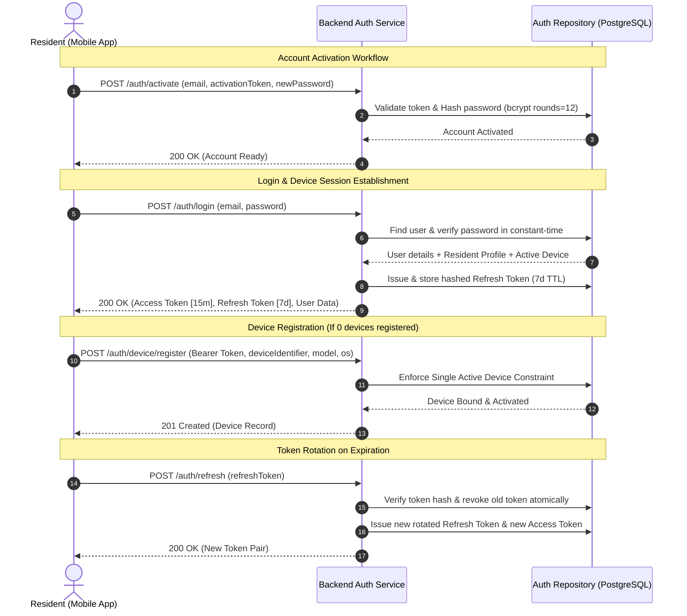
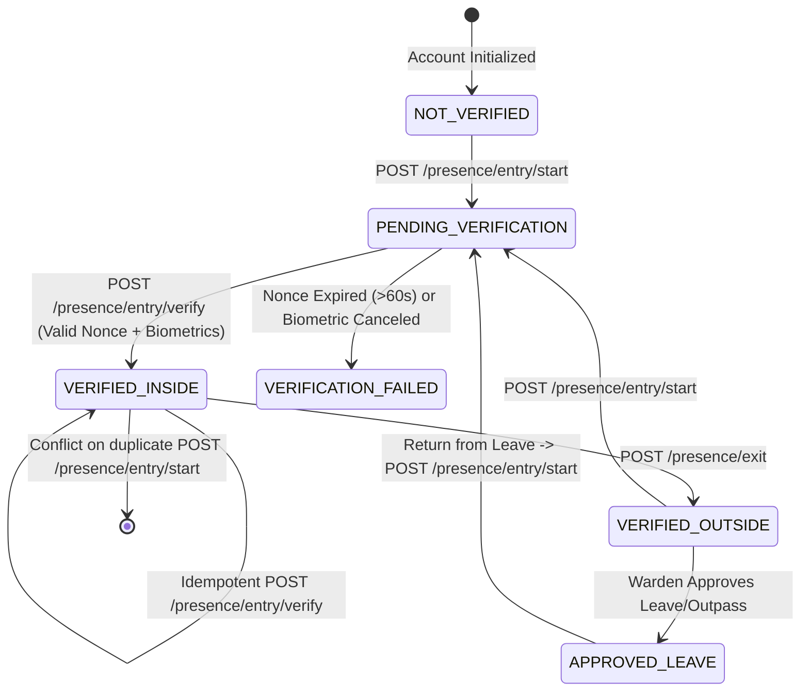

# API Specification & Authentication Architecture

## 1. Authentication Architecture & Security Model

The **Hostel Curfew & Multi-Factor Presence Verification System** implements an enterprise-grade, role-based token authentication mechanism designed to resist credential stuffing, session hijacking, replay attacks, and proxy attendance manipulation.



### Core Security Guardrails
1. **Password Hashing**: Uses `bcrypt` with cost factor 12. Login verification includes dummy hash comparison on non-existent accounts to eliminate timing side-channels and user enumeration.
2. **Access Token Lifespan**: Signed JWT access tokens have a short TTL of **15 minutes** with `HS256`.
3. **Rotating Refresh Tokens**: Stored as SHA-256 digests. Each refresh call revokes the existing refresh token and issues a new pair. If an already-consumed token is re-submitted, the session is invalidated immediately (theft detection).
4. **Hardware Device Binding**: A resident is restricted to **at most one active registered hardware device**. Attempts to register a second active device trigger HTTP `409 Conflict`.
5. **Brute-Force Rate Limiting**: Sensitive endpoints (`/auth/login`, `/auth/activate`) enforce an in-memory sliding window rate limiter (maximum 5 attempts per 15-minute window per IP) returning HTTP `429 Too Many Requests` with standard `Retry-After` headers.
6. **Strict RBAC Enforcement**: Role escalation is blocked server-side through `requireRoles(...)` middleware; UI element visibility is never treated as security.

---

## 2. Role-Based Access Control (RBAC) Matrix

| Endpoint | Permitted Roles | Notes |
| :--- | :--- | :--- |
| `POST /auth/login` | Public | Rate-limited (5 attempts / 15 min window) |
| `POST /auth/refresh` | Public (Requires valid Refresh Token) | Single-use rotation |
| `POST /auth/logout` | Public (Requires Refresh Token) | Revokes active session |
| `POST /auth/activate` | Public (Requires pre-provisioned activation token) | For new student onboarding |
| `POST /auth/device/register`| `RESIDENT` | Binds hardware device to student profile |
| `GET /resident/*` | `RESIDENT` | Resident curfew status & challenges |
| `GET /warden/*` | `WARDEN`, `ADMIN`, `SUPER_ADMIN` | Curfew rosters, alerts, exceptions |
| `GET /admin/*` | `ADMIN`, `SUPER_ADMIN` | Global hostel configs, audit ledgers |

---

## 3. Standard Request & Response Envelopes

### Success Envelope
```json
{
  "data": { ... },
  "message": "Human readable confirmation (optional)"
}
```

### Error Envelope (RFC 7807 Problem Details Pattern)
```json
{
  "error": {
    "code": "ERROR_CODE_STRING",
    "message": "Human readable explanation",
    "details": null
  },
  "timestamp": "2026-09-29T14:30:00.000Z"
}
```

---

## 4. Endpoint Specifications

### 4.1 `POST /auth/login`
Authenticates an active user and issues an access/refresh token pair.

**Request Body:**
```json
{
  "email": "aarav.patel@student.edu",
  "password": "SecureStudentPass!2026"
}
```

**Success Response (200 OK):**
```json
{
  "data": {
    "accessToken": "eyJhbGciOi...",
    "refreshToken": "eyJhbGciOi...",
    "expiresIn": "15m",
    "user": {
      "id": "c0000000-0000-0000-0000-000000000003",
      "name": "Aarav Patel",
      "email": "aarav.patel@student.edu",
      "role": "RESIDENT",
      "status": "ACTIVE",
      "residentProfile": {
        "id": "d0000000-0000-0000-0000-000000000001",
        "rollNumber": "CS2026-001",
        "hostelId": "a0000000-0000-0000-0000-000000000001",
        "roomId": "b0000000-0000-0000-0000-000000000101"
      },
      "activeDevice": {
        "id": "e0000000-0000-0000-0000-000000000001",
        "deviceIdentifier": "DEV-FINGERPRINT-AARAV-PIXEL8",
        "deviceModel": "Google Pixel 8",
        "status": "ACTIVE"
      }
    }
  },
  "message": "Authentication successful"
}
```

**Error Responses:**
- `400 VALIDATION_ERROR`: Missing or malformed email / password.
- `401 INVALID_CREDENTIALS`: Password mismatch or user not found.
- `401 ACCOUNT_PENDING_ACTIVATION`: Account must be activated first.
- `403 ACCOUNT_NOT_ACTIVE`: User suspended or deactivated.
- `429 RATE_LIMIT_EXCEEDED`: Exceeded 5 failed attempts in 15 minutes.

---

### 4.2 `POST /auth/refresh`
Rotates the refresh token and issues a new access token.

**Request Body:**
```json
{
  "refreshToken": "eyJhbGciOi..."
}
```

**Success Response (200 OK):**
```json
{
  "data": {
    "accessToken": "eyJhbGciOi...",
    "refreshToken": "eyJhbGciOi...",
    "expiresIn": "15m"
  },
  "message": "Token successfully refreshed"
}
```

**Error Responses:**
- `401 REFRESH_TOKEN_INVALID`: Token revoked, expired, or tampered.

---

### 4.3 `POST /auth/logout`
Explicitly revokes the active refresh token.

**Request Body:**
```json
{
  "refreshToken": "eyJhbGciOi..."
}
```

**Success Response (200 OK):**
```json
{
  "data": {
    "message": "Logged out successfully"
  }
}
```

---

### 4.4 `POST /auth/activate`
Enables a pre-provisioned resident account and configures the permanent password.

**Request Body:**
```json
{
  "email": "rohan.verma@student.edu",
  "activationToken": "ACTIVATE_ROHAN_2026_TOKEN",
  "newPassword": "RohanNewStrongPassword!2026"
}
```

**Success Response (200 OK):**
```json
{
  "data": {
    "message": "Account successfully activated. You may now log in with your credentials."
  }
}
```

**Error Responses:**
- `401 INVALID_ACTIVATION_TOKEN`: Provided token does not match.
- `403 FORBIDDEN`: Account already active.
- `404 NOT_FOUND`: Email not found.

---

### 4.5 `POST /auth/device/register`
Binds a physical hardware device to an authenticated resident.

**Headers:**
`Authorization: Bearer <accessToken>`

**Request Body:**
```json
{
  "deviceIdentifier": "NEW-HARDWARE-FINGERPRINT-12345",
  "deviceModel": "OnePlus 11",
  "osName": "ANDROID",
  "osVersion": "14.0"
}
```

**Success Response (201 Created):**
```json
{
  "data": {
    "device": {
      "id": "a1b2c3d4-0000-0000-0000-000000000001",
      "residentId": "d0000000-0000-0000-0000-000000000001",
      "deviceIdentifier": "NEW-HARDWARE-FINGERPRINT-12345",
      "deviceModel": "OnePlus 11",
      "osName": "ANDROID",
      "osVersion": "14.0",
      "status": "ACTIVE"
    }
  },
  "message": "Device registered successfully"
}
```

**Error Responses:**
- `401 AUTH_HEADER_MISSING`: Bearer token missing.
- `403 ROLE_NOT_AUTHORIZED`: User is not a `RESIDENT`.
- `409 CONFLICT`: Resident already has an active registered device or device identifier is already bound.

---

## 5. Presence & Curfew Verification Endpoints

The presence workflow manages physical boundary tracking (Hostel Entry/Exit) with anti-replay cryptographic nonces and authoritative server-side timestamps.

### 5.1 Presence State Transition Model



---

### 5.2 `POST /presence/entry/start`
Initiates a presence verification challenge for the authenticated resident. Enforces the duplicate entry constraint (resident cannot start a new entry if already verified inside).

**Headers:**
`Authorization: Bearer <accessToken>`

**Request Body (Optional):**
```json
{
  "deviceId": "e0000000-0000-0000-0000-000000000001",
  "clientMetadata": {
    "appVersion": "1.0.0",
    "networkBssid": "hostel-ap-north-1"
  }
}
```

**Success Response (200 OK):**
```json
{
  "data": {
    "sessionId": "9a1b2c3d-0000-0000-0000-000000000001",
    "challengeNonce": "4a7f9b8c2d1e0f3a5b7c9e1d3f5a7b9c2d1e0f3a5b7c9e1d3f5a7b9c2d1e0f3a",
    "challengeIssuedAt": "2026-09-29T14:30:00.000Z",
    "challengeExpiresAt": "2026-09-29T14:31:00.000Z",
    "deviceId": "e0000000-0000-0000-0000-000000000001",
    "residentId": "d0000000-0000-0000-0000-000000000001"
  },
  "message": "Verification challenge issued. Complete challenge before expiry."
}
```

**Error Responses:**
- `403 FORBIDDEN`: No active registered device or wrong hardware.
- `409 CONFLICT`: Duplicate active entry rejected (resident is already inside).

---

### 5.3 `POST /presence/entry/verify`
Submits challenge response and native biometric confirmation. Server verifies proof, consumes nonce, and creates an immutable presence record with **authoritative server timestamps**.

**Headers:**
`Authorization: Bearer <accessToken>`
`Idempotency-Key: <unique-client-uuid>` (Optional)

**Request Body:**
```json
{
  "sessionId": "9a1b2c3d-0000-0000-0000-000000000001",
  "challengeNonce": "4a7f9b8c2d1e0f3a5b7c9e1d3f5a7b9c2d1e0f3a5b7c9e1d3f5a7b9c2d1e0f3a",
  "biometricConfirmed": true,
  "networkMetadata": {
    "subnet": "10.42.0.0/16"
  }
}
```

**Success Response (200 OK):**
```json
{
  "data": {
    "eventId": "f1e2d3c4-0000-0000-0000-000000000001",
    "residentId": "d0000000-0000-0000-0000-000000000001",
    "eventType": "ENTRY",
    "status": "VERIFIED_INSIDE",
    "serverTimestamp": "2026-09-29T14:30:15.123Z",
    "curfewDate": "2026-09-29",
    "sessionId": "9a1b2c3d-0000-0000-0000-000000000001"
  },
  "message": "Presence verified successfully: Inside Hostel"
}
```

**Error Responses:**
- `400 VALIDATION_ERROR`: Challenge expired (>60s).
- `401 CHALLENGE_ALREADY_USED`: Replay attack attempt.
- `401 BIOMETRIC_FAILED`: Device biometric prompt was canceled or failed.
- `401 INVALID_CHALLENGE_PROOF`: Nonce hash mismatch.

---

### 5.4 `POST /presence/exit`
Records physical hostel departure, transitioning status to `VERIFIED_OUTSIDE`.

**Headers:**
`Authorization: Bearer <accessToken>`

**Request Body (Optional):**
```json
{
  "reason": "Attending campus library study session"
}
```

**Success Response (200 OK):**
```json
{
  "data": {
    "eventId": "f2e3d4c5-0000-0000-0000-000000000002",
    "residentId": "d0000000-0000-0000-0000-000000000001",
    "eventType": "EXIT",
    "status": "VERIFIED_OUTSIDE",
    "serverTimestamp": "2026-09-29T17:00:00.000Z",
    "curfewDate": "2026-09-29"
  },
  "message": "Exit recorded successfully: Outside Hostel"
}
```

---

### 5.5 `GET /presence/me`
Retrieves current presence state, active device, and recent presence audit logs for the authenticated student.

**Headers:**
`Authorization: Bearer <accessToken>`

**Success Response (200 OK):**
```json
{
  "data": {
    "residentId": "d0000000-0000-0000-0000-000000000001",
    "currentStatus": "VERIFIED_INSIDE",
    "lastEventType": "ENTRY",
    "lastEventTimestamp": "2026-09-29T14:30:15.123Z",
    "activeDevice": {
      "id": "e0000000-0000-0000-0000-000000000001",
      "deviceModel": "Google Pixel 8",
      "status": "ACTIVE"
    },
    "recentEvents": [
      {
        "id": "f1e2d3c4-0000-0000-0000-000000000001",
        "eventType": "ENTRY",
        "status": "VERIFIED_INSIDE",
        "serverTimestamp": "2026-09-29T14:30:15.123Z",
        "curfewDate": "2026-09-29"
      }
    ]
  }
}
```

---

### 5.6 `GET /presence/status`
Warden/Admin administrative overview or single-resident presence lookup.

**Permitted Roles:** `WARDEN`, `ADMIN`, `SUPER_ADMIN` (or `RESIDENT` for self-lookup)

**Query Parameters:**
- `hostelId` (Optional): Filter by hostel
- `residentId` (Optional): Lookup specific resident status

**Success Response (200 OK for Warden):**
```json
{
  "data": {
    "summary": {
      "totalTracked": 142,
      "verifiedInside": 135,
      "verifiedOutside": 7
    },
    "roster": [
      {
        "residentId": "d0000000-0000-0000-0000-000000000001",
        "status": "VERIFIED_INSIDE",
        "lastSeen": "2026-09-29T14:30:15.123Z"
      }
    ]
  }
}
```

