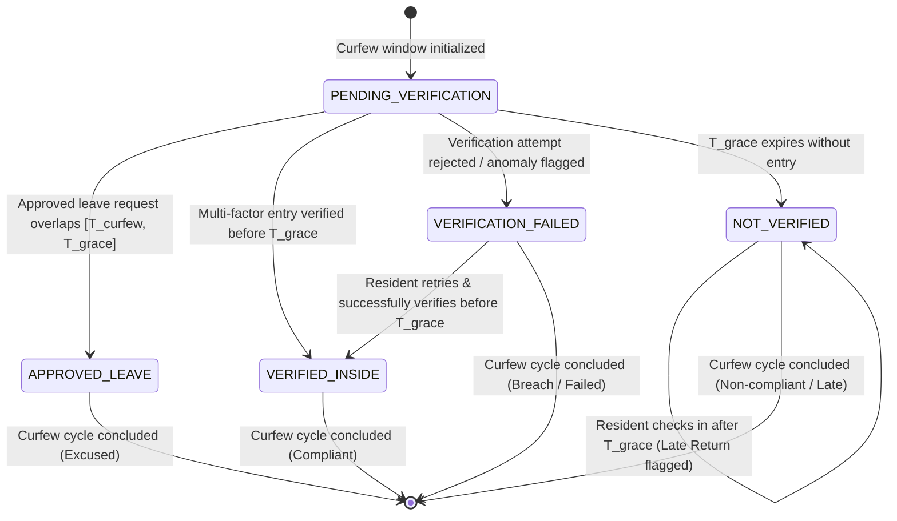

# Multi-Factor Hostel Curfew & Presence Verification System
## Architecture & Technical Specification

---

### 1. Executive Architecture Summary

The **Multi-Factor Hostel Curfew & Presence Verification System** is a distributed, security-first platform designed to enforce curfew deadlines and record verifiable student presence. Rather than relying on easily spoofed client-side assertions (such as phone GPS coordinates, client timestamps, or client-reported Wi-Fi SSIDs), the architecture mandates **multi-factor cryptographic and infrastructure-level evidence** evaluated strictly on the backend.

```mermaid
flowchart TD
    subgraph Client ["Client Device (Flutter)"]
        User(["Resident"]) --> MobileApp["Flutter Mobile App"]
        MobileApp --> BioSens["Native Biometrics (BiometricPrompt / LocalAuth)"]
        MobileApp --> KeyStore["Hardware KeyStore / Keychain Binding"]
    end

    subgraph Perimeter ["Campus Network Perimeter"]
        AP["Hostel Wi-Fi Access Points"]
        Gateway["Institutional Edge Gateway / Proxy"]
    end

    subgraph Backend ["Node.js + TypeScript API Cluster"]
        Router["Express API Router"]
        AuthModule["Auth & RBAC Module (JWT + Salted Bcrypt)"]
        PresenceSvc["Presence Service (Anti-Replay Orchestrator)"]
        NetLayer["Network-Verification Abstraction Layer"]
    end

    subgraph Storage ["PostgreSQL Cluster"]
        DB[(Relational DB: Users, Devices, Presence, Policies)]
    end

    MobileApp -->|1. POST /presence/entry/start| Router
    Router --> PresenceSvc
    PresenceSvc -->|Issue Nonce (60s TTL)| MobileApp

    MobileApp --> BioSens
    BioSens -->|Biometric Verified| MobileApp
    MobileApp -->|Connects via Hostel LAN| AP
    AP --> Gateway
    Gateway -->|2. POST /presence/entry/verify + Gateway Token + Subnet IP| Router
    Router --> AuthModule
    Router --> PresenceSvc
    PresenceSvc --> NetLayer
    NetLayer -->|Verify Subnet CIDR & Gateway Token| PresenceSvc
    PresenceSvc -->|Record Immutable Presence Event| DB
```

---

### 2. Multi-Factor Verification Pipeline

Presence inside a designated hostel residence is certified when **four independent factors** are satisfied during a single verification session:

1. **Identity & Authentication Factor**:
   - The resident must present a valid, unexpired JSON Web Token (`accessToken`) signed with HMAC-SHA256 (`HS256`) and associated with an `ACTIVE` resident account.
   - Suspended, deactivated, or unactivated accounts are rejected with `403 ACCOUNT_INACTIVE`.

2. **Registered Hardware Factor (Single-Device Binding)**:
   - Verification requests must originate from the resident's single, approved hardware device registered in the `devices` table (`status = 'ACTIVE'`).
   - The database enforces this via partial unique index `uq_resident_active_device`. Requests from unrecognized devices or residents with no active device are rejected with `403 FORBIDDEN`.

3. **Cryptographic Anti-Replay Nonce Challenge**:
   - When a resident begins verification (`POST /presence/entry/start`), the server generates a 32-byte cryptographically secure random token (`challengeNonce`) with a strict **60-second Time-To-Live (TTL)**.
   - The SHA-256 hash of this nonce is persisted in `verification_attempts`.
   - Upon verification submission (`POST /presence/entry/verify`), the server verifies `hashToken(clientNonce) === attempt.sessionNonceHash`.
   - The challenge is consumed atomically; subsequent attempts with the same nonce are blocked with `401 CHALLENGE_ALREADY_USED`.

4. **Institutional Network Evidence Verification**:
   - The resident's device must be demonstrably routing packets through the physical campus/hostel local area network.
   - Client-reported SSIDs are treated solely as observational metadata and **never** trusted as proof.
   - Network evidence is evaluated server-side via the **Network Verification Abstraction Layer**.

---

### 3. Network-Verification Abstraction Layer

The network layer decouples presence verification logic from physical network infrastructure, enabling seamless transition between development/testing environments and production campus deployments.

```
                           +------------------------------+
                           |   INetworkEvidenceProvider   |
                           +------------------------------+
                                          ^
                                          |
                      +-------------------+-------------------+
                      |                                       |
        +-----------------------------+         +-------------------------------+
        |     MockNetworkProvider     |         |    GatewayNetworkProvider     |
        |  (Development & Testing)    |         |   (Production Campus Edge)    |
        +-----------------------------+         +-------------------------------+
        - CIDR Subnet Range Matching            - Cryptographic Gateway Handshake
        - Configurable Hostel Subnets           - Institutional Reverse Proxy Token
        - Fault Simulation (Outage/Reject)      - Subnet Range Cross-Verification
```

#### 3.1 The Contract (`INetworkEvidenceProvider`)

```typescript
export interface NetworkVerificationContext {
  clientIp: string;
  hostelId?: string;
  residentId?: string;
  headers?: Record<string, string | string[] | undefined>;
  clientMetadata?: Record<string, unknown>;
}

export interface NetworkVerificationResult {
  verified: boolean;
  providerType: 'SUBNET_CIDR' | 'GATEWAY_IP' | 'MOCK_DEV' | 'API_CONTROLLER';
  providerName: string;
  evidence: NetworkVerificationEvidence;
  failureReason?:
    | 'IP_NOT_IN_AUTHORIZED_SUBNET'
    | 'MISSING_OR_INVALID_GATEWAY_TOKEN'
    | 'GATEWAY_UNREACHABLE'
    | 'HOSTEL_NETWORK_POLICY_NOT_FOUND'
    | 'NETWORK_PROVIDER_FAILURE'
    | 'SIMULATED_NETWORK_REJECTION';
}

export interface INetworkEvidenceProvider {
  readonly providerType: 'SUBNET_CIDR' | 'GATEWAY_IP' | 'MOCK_DEV' | 'API_CONTROLLER';
  readonly providerName: string;
  verifyNetworkEvidence(context: NetworkVerificationContext): Promise<NetworkVerificationResult>;
}
```

#### 3.2 Provider Implementations

1. **`MockNetworkProvider`**:
   - Used for unit testing, continuous integration, and local developer workflows.
   - Evaluates client IP addresses against CIDR subnets using bitwise IPv4 arithmetic (`isIpInCidr`).
   - Normalizes IPv6 loopback (`::1`) and IPv6-mapped IPv4 addresses (`::ffff:10.42.0.1` -> `10.42.0.1`).
   - Supports fault-injection toggles:
     - `simulateOutage(true)`: Returns `failureReason: 'GATEWAY_UNREACHABLE'`.
     - `setForceReject(true)`: Returns `failureReason: 'SIMULATED_NETWORK_REJECTION'`.
   - Maps hostel UUIDs to allowed CIDR blocks (e.g. Aryabhata Hall -> `10.42.0.0/16`).

2. **`GatewayNetworkProvider`**:
   - Designed for production campus enterprise topologies.
   - Validates that incoming traffic passed through an institutional gateway controller, edge router, or reverse proxy deployed on the hostel LAN perimeter.
   - Inspects headers:
     - `x-hostel-gateway-id`: Identifier of the edge gateway (e.g., `GATEWAY-HOSTEL-A-01`).
     - `x-hostel-gateway-token`: Secret shared handshake key or HMAC injected by trusted edge infrastructure.
   - Performs cross-verification against hostel CIDR subnets to prevent perimeter proxy evasion.
   - **Fail-Safe Policy**: Wrapped in robust exception handling. Any network failure, missing secret, or unrecognized gateway defaults to `verified: false`.

---

### 4. Authoritative Clock & State Consistency

To prevent curfew circumvention through device clock manipulation:
- **Server Clock Authority**: All timestamps (`challengeIssuedAt`, `challengeExpiresAt`, `serverTimestamp`, and `curfewDate`) are generated exclusively on the server using `new Date()`.
- **Client Timestamp Isolation**: Client-provided timestamps are relegated to untrusted debug fields and are never used to compute curfew status, grace periods, or violation flags.
- **Single Active Entry Constraint**: A resident cannot initiate or verify a new entry if they already have an active `VERIFIED_INSIDE` status without an intervening `EXIT` event (`409 Conflict`).
- **Idempotency Support**: Critical operations (`/presence/entry/verify`, `/presence/exit`) support `Idempotency-Key` headers, guaranteeing at-most-once execution during transient network retries.

---

### 5. Curfew Evaluation State Machine & Automated Engine Architecture

The Curfew Evaluation Engine (`services/api/src/modules/curfew-evaluation`) is an automated, deterministic service responsible for calculating and persisting the official curfew compliance status of every active hostel resident on any given date.

#### 5.1 Resident Curfew State Machine

Every resident is deterministically categorized into one of five mutually exclusive states:
- `PENDING_VERIFICATION`: The curfew enforcement window is open or upcoming, and the resident has not yet verified presence inside the hostel.
- `VERIFIED_INSIDE`: The resident successfully completed multi-factor entry verification prior to the curfew grace deadline and has not exited.
- `APPROVED_LEAVE`: The resident holds an approved leave request covering the curfew enforcement window ($[T_{\text{curfew}}, T_{\text{grace}}]$).
- `NOT_VERIFIED`: The grace deadline elapsed with no verified entry, OR the resident checked in after the grace deadline (late return).
- `VERIFICATION_FAILED`: The resident submitted a verification attempt that failed (e.g. unauthorized network, biometric mismatch, replay detected) without subsequent successful verification, or their presence record was flagged as anomalous.



#### 5.2 Curfew Windows and Temporal Deadlines

Deadlines are calculated in ISO 8601 format with explicit timezone offsets (e.g. `+05:30` for Indian Standard Time), guaranteeing deterministic evaluations across distributed server clusters regardless of host OS timezone settings:

$$T_{\text{curfew}} = \text{ISO}(\text{curfewDate}, \text{curfewTime}, \text{timezoneOffset})$$
$$T_{\text{grace}} = T_{\text{curfew}} + \Delta_{\text{graceMinutes}} \times 60000$$

1. **Active Check-In Window**: $[T_{\text{curfew}} - \Delta_{\text{lookback}}, T_{\text{curfew}}]$
   - Residents may begin checking in through the mobile app upon arriving at the hostel LAN perimeter.
   - Status remains `PENDING_VERIFICATION` until verification succeeds.
2. **Grace Window**: $[T_{\text{curfew}}, T_{\text{grace}}]$ (Default: 15 minutes)
   - Allowable transit/arrival margin. Entries during this window are certified as on-time (`VERIFIED_INSIDE`).
3. **Post-Grace / Violation Window**: $t > T_{\text{grace}}$
   - Any resident who has not verified and has no approved leave transitions from `PENDING_VERIFICATION` to `NOT_VERIFIED`.
   - Subsequent check-ins are recorded as **Late Returns** (`isLateReturn: true`), with exact elapsed minutes:
     $$\Delta_{\text{late}} = \left\lceil \frac{T_{\text{entry}} - T_{\text{grace}}}{60000} \right\rceil$$

#### 5.3 Deterministic Decision Matrix

The pure evaluation function (`evaluateResidentCurfew`) processes resident evidence according to the following precedence hierarchy:

| Priority | Evaluation Condition | Resulting Status | Key Metadata Persisted |
| :--- | :--- | :--- | :--- |
| **1** | Approved Leave request exists with `leaveStart <= T_grace` and `leaveEnd >= T_curfew` | `APPROVED_LEAVE` | `resolvedLeaveId`, leave type, end date |
| **2** | Most recent presence event before $T_{\text{grace}}$ has `status == 'FLAGGED'` | `VERIFICATION_FAILED` | `resolvedEventId`, anomaly rationale |
| **3** | Most recent presence event before $T_{\text{grace}}$ is `ENTRY` with `status == 'VERIFIED_INSIDE'` | `VERIFIED_INSIDE` | `resolvedEventId`, server timestamp |
| **4** | Entry verified strictly after $T_{\text{grace}}$ (Late Check-in) | `NOT_VERIFIED` | `resolvedEventId`, `isLateReturn = true`, `lateMinutes` |
| **5** | Verification attempt in curfew window has `status IN ('FAILED', 'REJECTED')` without subsequent successful entry | `VERIFICATION_FAILED` | Failure reason (e.g., `NETWORK_NOT_AUTHORIZED`) |
| **6** | Server evaluation time $t > T_{\text{grace}}$ with no presence and no leave | `NOT_VERIFIED` | Deadline elapsed rationale |
| **7** | Server evaluation time $t \le T_{\text{grace}}$ with no presence recorded | `PENDING_VERIFICATION` | Awaiting check-in rationale |

#### 5.4 Edge Case Resolution & Security Principles

- **Transient Failure Recovery**: If a resident experiences a transient network or biometric failure at 21:05 but succeeds in completing verification at 21:12 before $T_{\text{grace}}$, the successful entry supersedes the prior failure. The resident is certified as `VERIFIED_INSIDE`.
- **Chronological Deduplication**: If multiple entry events exist for the same resident (e.g. repeated mobile taps), events are sorted chronologically (`serverTimestamp`). A later `EXIT` invalidates an earlier `ENTRY`, ensuring residents who verified inside and subsequently exited before curfew are not erroneously marked inside.
- **Timezone-Safe Cross-Midnight Curfews**: Date and time strings are parsed with explicit UTC offsets (`normalizeTimezoneOffset`). For example, in IST (`+05:30`), a 21:30 curfew translates to 16:00 UTC of the same calendar date, while a 00:30 midnight curfew correctly advances to the next UTC day without date boundary regressions.
- **Warden & System Auditability**: Every evaluation cycle records an immutable snapshot in the `curfew_evaluations` repository. Wardens can trigger on-demand re-evaluations via `POST /admin/curfew/evaluate` or query historical records via `GET /admin/curfew/evaluation`.

