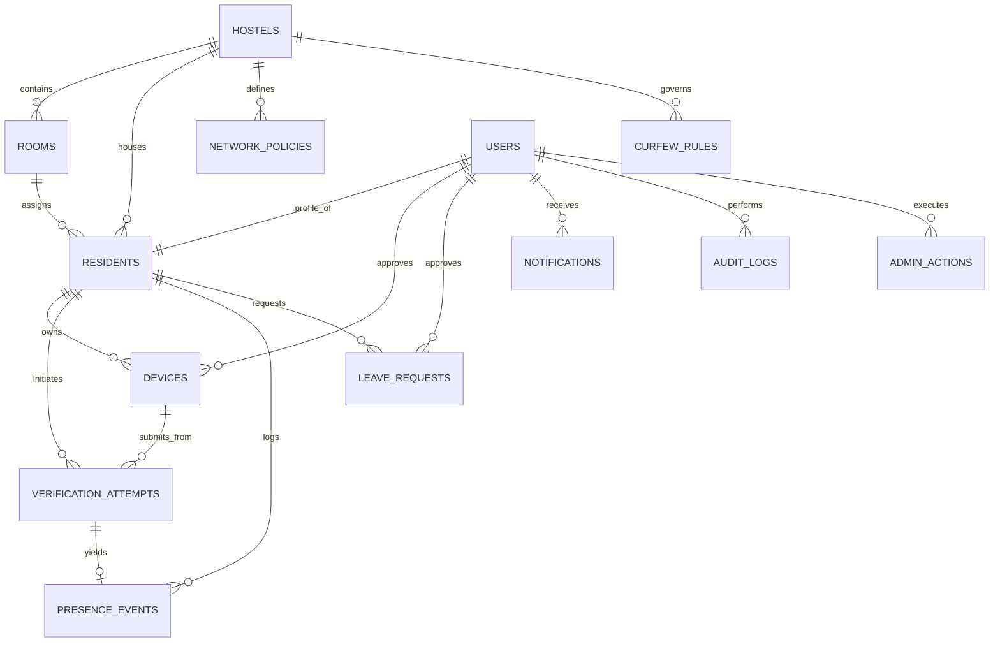

# Database Architecture & Relational Schema Specification

## 1. Architectural Overview & Design Philosophy

The relational database schema for the **Smart Hostel Curfew & Multi-Factor Presence Verification System** provides a tamper-evident, privacy-preserving, and relationally rigorous foundation for campus security operations. 

### Core Principles
- **No Raw Biometrics**: Device-native biometric authentication is validated on-device (via Android BiometricPrompt / iOS LocalAuthentication); the backend records only cryptographic verification outcomes and nonces, preventing liability under biometric privacy regulations.
- **Single Active Device Policy**: A student account can only have one active bound hardware device at any given point in time (enforced via PostgreSQL partial unique indexing), preventing account and device sharing.
- **Anti-Replay Cryptographic Nonces**: Verification sessions issue short-lived, time-bounded nonces ($\le 60\text{s}$) that are consumed atomically, preventing replay attacks using old network submissions or screenshots.
- **Immutable Auditability**: Sensitive administrative overrides and manual corrections require non-empty justification strings and write append-only records to `audit_logs` and `admin_actions`.
- **Deterministic Curfew State Resolution**: Physical network evidence and presence timestamps are decoupled from the final curfew state (`VERIFIED_INSIDE`, `APPROVED_LEAVE`, `PENDING_VERIFICATION`, `VERIFICATION_FAILED`, `NOT_VERIFIED`), ensuring institutional transparency.

---

## 2. Entity-Relationship Diagram (ERD)



---

## 3. Data Dictionary & Detailed Table Specifications

### 3.1 `hostels`
Represents physical hostel buildings within the campus.

| Column | Type | Constraints | Description |
| :--- | :--- | :--- | :--- |
| `id` | `UUID` | `PRIMARY KEY, DEFAULT gen_random_uuid()` | Unique identifier for the hostel. |
| `name` | `VARCHAR(100)` | `NOT NULL` | Display name (e.g., 'Aryabhata Hall of Residence'). |
| `code` | `VARCHAR(20)` | `NOT NULL, UNIQUE` | Unique short code used for routing/filtering (e.g., `HOSTEL-A`). |
| `address` | `TEXT` | `NULLABLE` | Physical campus address or building location. |
| `total_capacity` | `INT` | `NOT NULL, CHECK (total_capacity > 0)` | Maximum student capacity. |
| `is_active` | `BOOLEAN` | `NOT NULL, DEFAULT TRUE` | Operational state flag. |
| `created_at` | `TIMESTAMPTZ` | `NOT NULL, DEFAULT CURRENT_TIMESTAMP` | Record creation timestamp. |
| `updated_at` | `TIMESTAMPTZ` | `NOT NULL, DEFAULT CURRENT_TIMESTAMP` | Record modification timestamp. |

---

### 3.2 `rooms`
Represents individual student rooms within a hostel.

| Column | Type | Constraints | Description |
| :--- | :--- | :--- | :--- |
| `id` | `UUID` | `PRIMARY KEY, DEFAULT gen_random_uuid()` | Unique room identifier. |
| `hostel_id` | `UUID` | `NOT NULL, FK -> hostels(id) ON DELETE RESTRICT` | Associated hostel. Restricted on deletion if rooms exist. |
| `room_number` | `VARCHAR(20)` | `NOT NULL` | Room designation (e.g., '101', 'B-204'). |
| `floor` | `INT` | `NOT NULL, CHECK (floor >= 0)` | Building floor number (0 = Ground Floor). |
| `capacity` | `INT` | `NOT NULL, CHECK (capacity > 0)` | Maximum resident capacity. |
| `current_occupancy`| `INT` | `NOT NULL, DEFAULT 0, CHECK (0 <= occ <= cap)`| Current assigned count, bounded by capacity. |
| `is_active` | `BOOLEAN` | `NOT NULL, DEFAULT TRUE` | Availability flag. |
| `created_at` | `TIMESTAMPTZ` | `NOT NULL, DEFAULT CURRENT_TIMESTAMP` | Creation timestamp. |
| `updated_at` | `TIMESTAMPTZ` | `NOT NULL, DEFAULT CURRENT_TIMESTAMP` | Modification timestamp. |

*Table Constraints:*
- `CONSTRAINT uq_hostel_room UNIQUE (hostel_id, room_number)`: Guarantees unique room numbers within the same hostel.

---

### 3.3 `users`
Central identity entity representing all human actors (Residents, Wardens, Admins, Super Admins).

| Column | Type | Constraints | Description |
| :--- | :--- | :--- | :--- |
| `id` | `UUID` | `PRIMARY KEY, DEFAULT gen_random_uuid()` | Unique user identifier. |
| `name` | `VARCHAR(100)` | `NOT NULL` | Full legal name. |
| `email` | `VARCHAR(255)` | `NOT NULL, UNIQUE, CHECK (email ~* regex)` | Institutional email address. |
| `role` | `user_role` | `NOT NULL` | Enum: `'RESIDENT'`, `'WARDEN'`, `'ADMIN'`, `'SUPER_ADMIN'`. |
| `password_hash` | `VARCHAR(255)` | `NOT NULL` | Salted password hash (Argon2id/bcrypt). |
| `status` | `user_status` | `NOT NULL, DEFAULT 'PENDING_ACTIVATION'` | Enum: `'PENDING_ACTIVATION'`, `'ACTIVE'`, `'SUSPENDED'`, `'DEACTIVATED'`. |
| `created_at` | `TIMESTAMPTZ` | `NOT NULL, DEFAULT CURRENT_TIMESTAMP` | Account creation timestamp. |
| `updated_at` | `TIMESTAMPTZ` | `NOT NULL, DEFAULT CURRENT_TIMESTAMP` | Account update timestamp. |

---

### 3.4 `residents`
Student-specific profile extending `users` in a strict 1:1 relationship.

| Column | Type | Constraints | Description |
| :--- | :--- | :--- | :--- |
| `id` | `UUID` | `PRIMARY KEY, DEFAULT gen_random_uuid()` | Profile identifier. |
| `user_id` | `UUID` | `NOT NULL, UNIQUE, FK -> users(id) ON DELETE CASCADE`| 1:1 reference to the user record. |
| `roll_number` | `VARCHAR(50)` | `NOT NULL, UNIQUE` | Academic roll / matriculation number. |
| `hostel_id` | `UUID` | `NOT NULL, FK -> hostels(id) ON DELETE RESTRICT` | Assigned hostel building. |
| `room_id` | `UUID` | `NOT NULL, FK -> rooms(id) ON DELETE RESTRICT` | Assigned room. |
| `emergency_contact_name` | `VARCHAR(100)` | `NOT NULL` | Parent / Guardian contact name. |
| `emergency_contact_phone` | `VARCHAR(20)` | `NOT NULL` | Parent / Guardian telephone number. |
| `created_at` | `TIMESTAMPTZ` | `NOT NULL, DEFAULT CURRENT_TIMESTAMP` | Timestamp. |
| `updated_at` | `TIMESTAMPTZ` | `NOT NULL, DEFAULT CURRENT_TIMESTAMP` | Timestamp. |

---

### 3.5 `devices`
Tracks hardware devices bound to a resident account to mitigate credential sharing and proxy check-ins.

| Column | Type | Constraints | Description |
| :--- | :--- | :--- | :--- |
| `id` | `UUID` | `PRIMARY KEY, DEFAULT gen_random_uuid()` | Device record ID. |
| `resident_id` | `UUID` | `NOT NULL, FK -> residents(id) ON DELETE CASCADE`| Resident owner. |
| `device_identifier` | `VARCHAR(255)` | `NOT NULL, UNIQUE` | SHA-256 fingerprint / secure hardware instance token. |
| `device_model` | `VARCHAR(100)` | `NOT NULL` | Manufacturer and model (e.g., 'Google Pixel 8'). |
| `os_name` | `VARCHAR(50)` | `NOT NULL, CHECK (os_name IN ('ANDROID', 'IOS', 'TEST_OS'))` | Operating system platform. |
| `os_version` | `VARCHAR(50)` | `NOT NULL` | Platform OS build/version. |
| `status` | `device_status`| `NOT NULL, DEFAULT 'PENDING_APPROVAL'` | Enum: `'PENDING_APPROVAL'`, `'ACTIVE'`, `'REVOKED'`. |
| `registered_at` | `TIMESTAMPTZ` | `NOT NULL, DEFAULT CURRENT_TIMESTAMP` | Timestamp of initial binding request. |
| `approved_by` | `UUID` | `NULLABLE, FK -> users(id) ON DELETE SET NULL` | Administrator who validated device ownership. |
| `revoked_at` | `TIMESTAMPTZ` | `NULLABLE` | Timestamp when revoked/decommissioned. |
| `revocation_reason` | `TEXT` | `NULLABLE` | Explanation if revoked. |
| `created_at` | `TIMESTAMPTZ` | `NOT NULL, DEFAULT CURRENT_TIMESTAMP` | Timestamp. |
| `updated_at` | `TIMESTAMPTZ` | `NOT NULL, DEFAULT CURRENT_TIMESTAMP` | Timestamp. |

*Critical Constraints & Indexes:*
- `CREATE UNIQUE INDEX uq_resident_active_device ON devices (resident_id) WHERE status = 'ACTIVE'`: Enforces that a resident can have **at most one** active device.
- `CONSTRAINT chk_device_revocation`: Enforces that a `REVOKED` device must include a non-null `revoked_at` timestamp.

---

### 3.6 `network_policies`
Defines institutional network verification criteria per hostel (pluggable network verification abstraction).

| Column | Type | Constraints | Description |
| :--- | :--- | :--- | :--- |
| `id` | `UUID` | `PRIMARY KEY, DEFAULT gen_random_uuid()` | Policy ID. |
| `hostel_id` | `UUID` | `NOT NULL, FK -> hostels(id) ON DELETE CASCADE` | Hostel where this policy applies. |
| `policy_name` | `VARCHAR(100)`| `NOT NULL` | Policy label (e.g. 'Aryabhata Internal Wi-Fi CIDR'). |
| `provider_type` | `network_provider_type` | `NOT NULL` | Enum: `'SUBNET_CIDR'`, `'GATEWAY_IP'`, `'MOCK_DEV'`, `'API_CONTROLLER'`. |
| `network_identifier` | `VARCHAR(255)`| `NOT NULL` | Subnet CIDR (e.g. `10.42.0.0/16`) or Gateway Identifier. |
| `is_active` | `BOOLEAN` | `NOT NULL, DEFAULT TRUE` | Active enforcement flag. |
| `created_at` | `TIMESTAMPTZ` | `NOT NULL, DEFAULT CURRENT_TIMESTAMP` | Timestamp. |
| `updated_at` | `TIMESTAMPTZ` | `NOT NULL, DEFAULT CURRENT_TIMESTAMP` | Timestamp. |

*Table Constraints:*
- `CONSTRAINT uq_hostel_network_policy UNIQUE (hostel_id, policy_name)`

---

### 3.7 `verification_attempts`
Manages verification sessions, anti-replay cryptographic nonces, and challenge lifecycles.

| Column | Type | Constraints | Description |
| :--- | :--- | :--- | :--- |
| `id` | `UUID` | `PRIMARY KEY, DEFAULT gen_random_uuid()` | Verification attempt ID. |
| `resident_id` | `UUID` | `NOT NULL, FK -> residents(id) ON DELETE CASCADE` | Resident undergoing verification. |
| `device_id` | `UUID` | `NOT NULL, FK -> devices(id) ON DELETE RESTRICT` | Device executing verification. |
| `session_nonce_hash`| `VARCHAR(64)` | `NOT NULL, UNIQUE` | SHA-256 hash of server-issued single-use nonce. |
| `challenge_issued_at`| `TIMESTAMPTZ` | `NOT NULL, DEFAULT CURRENT_TIMESTAMP` | Generation timestamp. |
| `challenge_expires_at`| `TIMESTAMPTZ` | `NOT NULL, CHECK (expires_at > issued_at)` | Challenge TTL ($\le 60\text{ seconds}$). |
| `biometric_verified`| `BOOLEAN` | `NOT NULL, DEFAULT FALSE` | OS-level biometric confirmation signal. |
| `network_verified` | `BOOLEAN` | `NOT NULL, DEFAULT FALSE` | Institutional network verification signal. |
| `status` | `verification_status` | `NOT NULL, DEFAULT 'PENDING'` | Enum: `'PENDING'`, `'VERIFIED'`, `'EXPIRED'`, `'FAILED'`, `'REJECTED'`. |
| `failure_reason` | `VARCHAR(255)` | `NULLABLE` | Explanation code if verification failed. |
| `consumed_at` | `TIMESTAMPTZ` | `NULLABLE, CHECK (consumed_at >= issued_at)` | Timestamp when nonce was used (anti-replay). |
| `client_metadata` | `JSONB` | `NOT NULL, DEFAULT '{}'` | Sanitized client environment info. |
| `created_at` | `TIMESTAMPTZ` | `NOT NULL, DEFAULT CURRENT_TIMESTAMP` | Creation timestamp. |
| `updated_at` | `TIMESTAMPTZ` | `NOT NULL, DEFAULT CURRENT_TIMESTAMP` | Modification timestamp. |

---

### 3.8 `presence_events`
Authoritative, immutable event log of physical presence changes (curfew entry/exit).

| Column | Type | Constraints | Description |
| :--- | :--- | :--- | :--- |
| `id` | `UUID` | `PRIMARY KEY, DEFAULT gen_random_uuid()` | Event ID. |
| `resident_id` | `UUID` | `NOT NULL, FK -> residents(id) ON DELETE RESTRICT`| Resident subject. |
| `event_type` | `presence_event_type` | `NOT NULL` | Enum: `'ENTRY'`, `'EXIT'`. |
| `source` | `presence_source` | `NOT NULL, DEFAULT 'VERIFICATION_SESSION'` | Enum: `'VERIFICATION_SESSION'`, `'WARDEN_MANUAL'`, `'ADMIN_OVERRIDE'`. |
| `verification_attempt_id` | `UUID` | `NULLABLE, FK -> verification_attempts(id) ON DELETE SET NULL` | Linked verification attempt (if self-service). |
| `event_timestamp` | `TIMESTAMPTZ` | `NOT NULL, DEFAULT CURRENT_TIMESTAMP` | Reported client event time. |
| `server_timestamp`| `TIMESTAMPTZ` | `NOT NULL, DEFAULT CURRENT_TIMESTAMP` | Authoritative server clock time. |
| `curfew_date` | `DATE` | `NOT NULL` | Calendar date for curfew accounting. |
| `status` | `presence_event_status` | `NOT NULL` | Enum: `'VERIFIED_INSIDE'`, `'VERIFIED_OUTSIDE'`, `'FLAGGED'`. |
| `network_evidence`| `JSONB` | `NOT NULL, DEFAULT '{}'` | Ingested network evidence metadata. |
| `created_at` | `TIMESTAMPTZ` | `NOT NULL, DEFAULT CURRENT_TIMESTAMP` | Record creation timestamp. |

---

### 3.9 `curfew_rules`
Defines hostel curfew times, day-of-week policies, and grace periods.

| Column | Type | Constraints | Description |
| :--- | :--- | :--- | :--- |
| `id` | `UUID` | `PRIMARY KEY, DEFAULT gen_random_uuid()` | Rule ID. |
| `hostel_id` | `UUID` | `NOT NULL, FK -> hostels(id) ON DELETE CASCADE` | Target hostel. |
| `day_of_week` | `INT` | `NULLABLE, CHECK (0 <= day_of_week <= 6)` | 0 = Sunday, 6 = Saturday; NULL = daily default. |
| `curfew_time` | `TIME` | `NOT NULL` | Deadline time (e.g. `'21:30:00'`). |
| `grace_period_minutes`| `INT` | `NOT NULL, DEFAULT 15, CHECK (grace >= 0)` | Allowable grace window in minutes. |
| `is_active` | `BOOLEAN` | `NOT NULL, DEFAULT TRUE` | Active rule flag. |
| `effective_from` | `DATE` | `NOT NULL, DEFAULT CURRENT_DATE` | Start date of rule validity. |
| `effective_to` | `DATE` | `NULLABLE, CHECK (to IS NULL OR to >= from)` | Expiration date of rule validity. |
| `created_at` | `TIMESTAMPTZ` | `NOT NULL, DEFAULT CURRENT_TIMESTAMP` | Timestamp. |
| `updated_at` | `TIMESTAMPTZ` | `NOT NULL, DEFAULT CURRENT_TIMESTAMP` | Timestamp. |

---

### 3.10 `leave_requests`
Resident outpass and overnight leave applications.

| Column | Type | Constraints | Description |
| :--- | :--- | :--- | :--- |
| `id` | `UUID` | `PRIMARY KEY, DEFAULT gen_random_uuid()` | Leave request ID. |
| `resident_id` | `UUID` | `NOT NULL, FK -> residents(id) ON DELETE CASCADE`| Resident requesting leave. |
| `leave_type` | `leave_type` | `NOT NULL` | Enum: `'OUTPASS'`, `'NIGHT_OUT'`, `'EMERGENCY'`, `'HOME_VISIT'`. |
| `start_time` | `TIMESTAMPTZ` | `NOT NULL` | Leave departure window. |
| `end_time` | `TIMESTAMPTZ` | `NOT NULL, CHECK (end_time > start_time)` | Expected return deadline. |
| `reason` | `TEXT` | `NOT NULL` | Justification provided by resident. |
| `status` | `leave_status`| `NOT NULL, DEFAULT 'PENDING'` | Enum: `'PENDING'`, `'APPROVED'`, `'REJECTED'`, `'CANCELLED'`. |
| `approver_id` | `UUID` | `NULLABLE, FK -> users(id) ON DELETE SET NULL` | Warden/Admin who reviewed request. |
| `decision_reason` | `TEXT` | `NULLABLE` | Explanation for approval/rejection. |
| `decision_timestamp`| `TIMESTAMPTZ` | `NULLABLE` | Time when decision was rendered. |
| `created_at` | `TIMESTAMPTZ` | `NOT NULL, DEFAULT CURRENT_TIMESTAMP` | Request timestamp. |
| `updated_at` | `TIMESTAMPTZ` | `NOT NULL, DEFAULT CURRENT_TIMESTAMP` | Modification timestamp. |

*Table Constraints:*
- `CONSTRAINT chk_leave_duration CHECK (end_time > start_time)`
- `CONSTRAINT chk_leave_decision`: Guarantees that if `status` is `'APPROVED'` or `'REJECTED'`, `approver_id` and `decision_timestamp` must not be null.

---

### 3.11 `notifications`
System and curfew alert inbox for mobile and administrative clients.

| Column | Type | Constraints | Description |
| :--- | :--- | :--- | :--- |
| `id` | `UUID` | `PRIMARY KEY, DEFAULT gen_random_uuid()` | Notification ID. |
| `user_id` | `UUID` | `NOT NULL, FK -> users(id) ON DELETE CASCADE` | Recipient user. |
| `title` | `VARCHAR(200)` | `NOT NULL` | Alert headline. |
| `body` | `TEXT` | `NOT NULL` | Alert body content. |
| `type` | `notification_type` | `NOT NULL` | Enum: `'CURFEW_ALERT'`, `'VERIFICATION_REQUEST'`, `'LEAVE_UPDATE'`, `'SYSTEM_NOTICE'`. |
| `is_read` | `BOOLEAN` | `NOT NULL, DEFAULT FALSE` | Read receipt flag. |
| `read_at` | `TIMESTAMPTZ` | `NULLABLE` | Timestamp when read. |
| `metadata` | `JSONB` | `NOT NULL, DEFAULT '{}'` | Actionable payload (e.g. route parameters). |
| `created_at` | `TIMESTAMPTZ` | `NOT NULL, DEFAULT CURRENT_TIMESTAMP` | Alert timestamp. |

---

### 3.12 `audit_logs`
Immutable, append-only ledger of security-critical actions and state transitions.

| Column | Type | Constraints | Description |
| :--- | :--- | :--- | :--- |
| `id` | `UUID` | `PRIMARY KEY, DEFAULT gen_random_uuid()` | Audit log ID. |
| `actor_id` | `UUID` | `NULLABLE, FK -> users(id) ON DELETE SET NULL` | User performing the action (NULL for system cron). |
| `actor_role` | `VARCHAR(50)` | `NOT NULL` | Cached role at action time. |
| `action` | `VARCHAR(100)`| `NOT NULL` | Action code (e.g. `'MANUAL_CORRECTION'`). |
| `target_entity`| `VARCHAR(100)`| `NOT NULL` | Target table name (e.g. `'devices'`, `'presence_events'`). |
| `target_id` | `VARCHAR(255)`| `NOT NULL` | Primary key of affected record. |
| `previous_state`| `JSONB` | `NULLABLE` | State before modification. |
| `new_state` | `JSONB` | `NULLABLE` | State after modification. |
| `reason` | `TEXT` | `NOT NULL, CHECK (char_length(trim(reason)) > 0)` | Mandatory justification string. |
| `ip_address` | `VARCHAR(45)` | `NULLABLE` | Originating IP address (IPv4 or IPv6). |
| `timestamp` | `TIMESTAMPTZ` | `NOT NULL, DEFAULT CURRENT_TIMESTAMP` | Authoritative log timestamp. |

*Database Immutability Constraints & Triggers:*
- `trg_audit_logs_immutability`: BEFORE UPDATE OR DELETE trigger executing `prevent_audit_log_modification()`, which raises SQLSTATE `55000` to prevent any modification or deletion.
- Role-level permissions: `REVOKE UPDATE, DELETE ON audit_logs FROM PUBLIC, app_user, resident_role, warden_role;`.

---

### 3.13 `admin_actions`
High-level administrative governance decisions (e.g., curfew policy changes, bulk overrides, user status alterations, device revocations).

| Column | Type | Constraints | Description |
| :--- | :--- | :--- | :--- |
| `id` | `UUID` | `PRIMARY KEY, DEFAULT gen_random_uuid()` | Action record ID. |
| `admin_id` | `UUID` | `NOT NULL, FK -> users(id) ON DELETE RESTRICT` | Administrator performing action. |
| `action_type` | `admin_action_type` | `NOT NULL` | Enum: `'CURFEW_RULE_CHANGE'`, `'BULK_STATUS_OVERRIDE'`, `'USER_STATUS_CHANGE'`, `'DEVICE_REVOCATION'`, etc. |
| `target_id` | `VARCHAR(255)`| `NOT NULL` | Target subject identifier. |
| `details` | `JSONB` | `NOT NULL, DEFAULT '{}'` | Parameter payload. |
| `justification`| `TEXT` | `NOT NULL, CHECK (char_length(trim(justification)) > 0)` | Mandatory institutional reason. |
| `created_at` | `TIMESTAMPTZ` | `NOT NULL, DEFAULT CURRENT_TIMESTAMP` | Execution timestamp. |

*Database Immutability Constraints & Triggers:*
- `trg_admin_actions_immutability`: BEFORE UPDATE OR DELETE trigger executing `prevent_audit_log_modification()` ensuring governance records cannot be modified or purged.
- Role-level permissions: `REVOKE UPDATE, DELETE ON admin_actions FROM PUBLIC, app_user, resident_role, warden_role;`.

---

## 4. Performance & Composite Indexes

| Table | Index Name | Indexed Columns | Query Purpose |
| :--- | :--- | :--- | :--- |
| `presence_events` | `idx_presence_events_lookup` | `(resident_id, curfew_date, status)` | High-speed curfew resolution query per resident per night. |
| `presence_events` | `idx_presence_events_server_timestamp` | `(server_timestamp DESC)` | Chronological audit and warden live monitoring feed. |
| `devices` | `uq_resident_active_device` | `(resident_id) WHERE status = 'ACTIVE'` | Partial index guaranteeing at most 1 active device per student. |
| `verification_attempts` | `idx_verification_attempts_nonce` | `(session_nonce_hash)` | O(1) single-use anti-replay nonce validation. |
| `verification_attempts` | `idx_verification_attempts_expiry` | `(challenge_expires_at)` | Automated cleanup and TTL expiration scanning. |
| `leave_requests` | `idx_leave_requests_active_window` | `(resident_id, status, start_time, end_time)` | Curfew engine lookup: is resident currently on approved leave? |
| `audit_logs` | `idx_audit_logs_actor` | `(actor_id, timestamp DESC)` | Per-staff administrative audit queries. |
| `audit_logs` | `idx_audit_logs_target` | `(target_entity, target_id)` | Complete lifecycle change history for any record. |
| `notifications` | `idx_notifications_user_unread` | `(user_id, is_read)` | Mobile push notification badge sync. |

---

## 5. Applying Migrations and Seeds

### Step 1: Sequential Migration Execution (PostgreSQL)
```bash
# Execute schema migrations 001 through 009 in strict order:
psql -U postgres -d hostel_curfew -f database/migrations/001_initial_schema.sql
psql -U postgres -d hostel_curfew -f database/migrations/009_enforce_audit_immutability.sql
```

### Step 2: Ingest Development Seed Data
```bash
psql -U postgres -d hostel_curfew -f database/seeds/001_development_seed.sql
```

