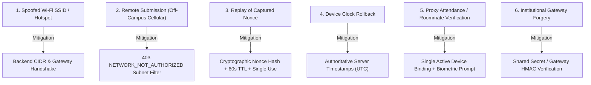

# Multi-Factor Hostel Curfew & Presence Verification System
## Threat Model & Security Architecture

---

### 1. Overview & Threat Modeling Methodology

The threat model for the hostel curfew verification system uses the **STRIDE** methodology (Spoofing, Tampering, Repudiation, Information Disclosure, Denial of Service, Elevation of Privilege) with specific focus on **bypassing curfew enforcement and attendance fraud**.

Curfew verification systems operate in an untrusted execution environment: the student controls the physical device, the operating system environment, and the network transport interface. Consequently, **no client-reported data (timestamps, SSIDs, location strings, or boolean flags) is considered authoritative**.

---

### 2. Threat Analysis & Security Controls

---

#### Threat 1: Spoofed Client Wi-Fi SSID / Rogue Access Point
- **Attack Vector**: A student outside campus creates a personal Wi-Fi hotspot named `HostelAryabhata_WiFi` and submits `{ clientSsid: 'HostelAryabhata_WiFi' }` in the request payload.
- **Severity**: Critical.
- **Architectural Countermeasure**:
  - The server treats all client-reported network metadata as **observational hints only**.
  - Verification is evaluated exclusively by `INetworkEvidenceProvider` using server-observed network evidence:
    - In `MockNetworkProvider`: Verifies that the client's socket/proxy IPv4 address is within the institutional subnet CIDR assigned to that hostel (e.g., `10.42.0.0/16`).
    - In `GatewayNetworkProvider`: Requires cryptographic handshake headers (`x-hostel-gateway-id`, `x-hostel-gateway-token`) injected only by institutional edge proxies.
  - Rogue SSIDs operating on external IP ranges fail subnet matching and receive `403 NETWORK_NOT_AUTHORIZED`.

---

#### Threat 2: Remote Submission via Cellular or External Broadband
- **Attack Vector**: A student staying at an off-campus party attempts to submit presence verification over mobile data (4G/5G) before the 9:30 PM curfew.
- **Severity**: High.
- **Architectural Countermeasure**:
  - Incoming requests route through public cellular carrier IP spaces (e.g. `198.51.100.x` or CGNAT `100.64.0.0/10`).
  - The subnet validation engine computes bitwise mask matching against the resident's registered hostel policy in `network_policies`.
  - Non-matching IPs are rejected immediately with HTTP 403 `NETWORK_NOT_AUTHORIZED`, and the `verification_attempts` record is updated to `status: 'FAILED', failureReason: 'IP_NOT_IN_AUTHORIZED_SUBNET'`.

---

#### Threat 3: Replay Attacks & Pre-Recorded Verification Payloads
- **Attack Vector**: An attacker captures a successful verification request payload and attempts to replay it on subsequent days or after curfew hours.
- **Severity**: Critical.
- **Architectural Countermeasure**:
  - Verification requires a two-step challenge-response handshake (`POST /presence/entry/start` followed by `POST /presence/entry/verify`).
  - Each challenge issues a unique 32-byte cryptographic nonce with a strict **60-second TTL**.
  - Nonces are stored as SHA-256 hashes in `verification_attempts`.
  - Upon verification, the session is atomically marked `status = 'VERIFIED'` and `consumedAt = NOW()`. Any duplicate submission with the same nonce fails with `401 CHALLENGE_ALREADY_USED`.

---

#### Threat 4: Device Clock Tampering (Time Travel Attack)
- **Attack Vector**: A student arrives back at the hostel at 11:30 PM (past the 9:30 PM curfew), turns off network automatic time, sets their phone clock back to 9:15 PM, and submits verification.
- **Severity**: High.
- **Architectural Countermeasure**:
  - The backend generates all timestamps server-side (`serverTimestamp = new Date()`, `curfewDate = serverTimestamp.toISOString().split('T')[0]`).
  - Client timestamps (`clientTimestamp`) in request payloads are logged purely for telemetry and clock drift auditing; they have zero effect on verification validity, curfew evaluation, or grace period calculations.

---

#### Threat 5: Proxy Attendance & Device Sharing ("Buddy Punching")
- **Attack Vector**: A student leaves their smartphone in their hostel room with a friend while remaining outside campus. The friend attempts to verify attendance on their behalf.
- **Severity**: High.
- **Architectural Countermeasure**:
  - **Single Active Device Policy**: A student may bind only **one** physical hardware device at a time, enforced via partial unique index `uq_resident_active_device`.
  - **Native Biometrics**: Entry verification requires native hardware biometric confirmation (`LocalAuth` / `BiometricPrompt`). The friend cannot pass biometric authentication without the registered student's biometric signature or device passcode.
  - **Audit Logging & Warden Overrides**: Random physical room spot-checks by wardens cross-reference resident logs (`audit_logs`) and can flag suspicious repeated verification patterns.

---

#### Threat 6: Institutional Gateway Header Forgery
- **Attack Vector**: A tech-savvy student attempts to inject `X-Hostel-Gateway-Token` and `X-Hostel-Gateway-Id` headers into an HTTP request from an unauthorized network.
- **Severity**: High.
- **Architectural Countermeasure**:
  - Campus reverse proxies and firewalls strip all inbound external `X-Hostel-*` headers at the campus border router.
  - `GatewayNetworkProvider` requires **both** a valid shared secret token **and** client IP subnet match (`enforceSubnetCheck: true`). Even if an internal student guesses a gateway token, the request must originate from an authorized hostel subnet IP.

---

#### Threat 7: Network Outages & Fail-Safe Defaults
- **Attack Vector**: A power glitch or fiber cut renders the institutional Wi-Fi controller or edge gateway unreachable during the curfew verification window.
- **Severity**: Medium.
- **Architectural Countermeasure**:
  - **Fail-Safe Principle**: The network provider defaults to safe rejection (`verified: false`, `failureReason: 'GATEWAY_UNREACHABLE'`). The system **never fails open** to prevent attackers from inducing artificial outages to bypass curfews.
  - Outages are logged with high-severity audit entries. Wardens can consult real-time roster dashboards and issue authorized manual curfew overrides (`source: 'WARDEN_MANUAL'`) or approved leave requests (`leave_requests`).

---

### 3. Residual Risks & Operational Compensating Controls

| Residual Risk | Likelihood | Impact | Compensating Operational Control |
| :--- | :--- | :--- | :--- |
| **Device left in hostel room with shared passcode** | Low | Medium | Multi-factor correlation: warden nightly floor inspections cross-referenced with presence roster. |
| **Wi-Fi bleed outside hostel boundary** | Medium | Low | Fine-tuned Wi-Fi AP transmission power (Tx power calibration) to restrict coverage to building perimeter; physical hostel entry turnstiles. |
| **Campus Wi-Fi hardware failure during curfew** | Low | High | Automated warden fallback mode allowing Warden Manual Verification (`WARDEN_MANUAL`) with mandatory reason logging in `audit_logs`. |
