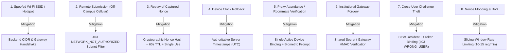

# Multi-Factor Hostel Curfew & Presence Verification System
## Threat Model & Security Architecture

---

### 1. Overview & Threat Modeling Methodology

The threat model for the hostel curfew verification system uses the **STRIDE** methodology (Spoofing, Tampering, Repudiation, Information Disclosure, Denial of Service, Elevation of Privilege) with specific focus on **bypassing curfew enforcement and attendance fraud**.

Curfew verification systems operate in an untrusted execution environment: the student controls the physical device, the operating system environment, and the network transport interface. Consequently, **no client-reported data (timestamps, SSIDs, location strings, or boolean flags) is considered authoritative**.

---

### 2. Threat Analysis & Security Controls

---

#### Threat 1: Spoofed Client Wi-Fi SSID / Rogue Access Point
- **Attack Vector**: A student outside campus creates a personal Wi-Fi hotspot named `HostelAryabhata_WiFi` and submits `{ clientSsid: 'HostelAryabhata_WiFi' }` in the request payload.
- **Severity**: Critical.
- **Architectural Countermeasure**:
  - The server treats all client-reported network metadata as **observational hints only**.
  - Verification is evaluated exclusively by `INetworkEvidenceProvider` using server-observed network evidence:
    - In `MockNetworkProvider`: Verifies that the client's socket/proxy IPv4 address is within the institutional subnet CIDR assigned to that hostel (e.g., `10.42.0.0/16`).
    - In `GatewayNetworkProvider`: Requires cryptographic handshake headers (`x-hostel-gateway-id`, `x-hostel-gateway-token`) injected only by institutional edge proxies.
  - Rogue SSIDs operating on external IP ranges fail subnet matching and receive `403 NETWORK_NOT_AUTHORIZED`.

---

#### Threat 2: Remote Submission via Cellular or External Broadband
- **Attack Vector**: A student staying at an off-campus party attempts to submit presence verification over mobile data (4G/5G) before the 9:30 PM curfew.
- **Severity**: High.
- **Architectural Countermeasure**:
  - Incoming requests route through public cellular carrier IP spaces (e.g. `198.51.100.x` or CGNAT `100.64.0.0/10`).
  - The subnet validation engine computes bitwise mask matching against the resident's registered hostel policy in `network_policies`.
  - Non-matching IPs are rejected immediately with HTTP 403 `NETWORK_NOT_AUTHORIZED`, and the `verification_attempts` record is updated to `status: 'FAILED', failureReason: 'IP_NOT_IN_AUTHORIZED_SUBNET'`.

---

#### Threat 3: Replay Attacks & Pre-Recorded Verification Payloads
- **Attack Vector**: An attacker captures a successful verification request payload and attempts to replay it on subsequent days or after curfew hours.
- **Severity**: Critical.
- **Architectural Countermeasure**:
  - Verification requires a two-step challenge-response handshake (`POST /presence/entry/start` followed by `POST /presence/entry/verify`).
  - Each challenge issues a unique 32-byte cryptographic nonce with a strict **60-second TTL**.
  - Nonces are stored as SHA-256 hashes in `verification_attempts`.
  - Upon verification, the session is atomically marked `status = 'VERIFIED'` and `consumedAt = NOW()`. Any duplicate submission with the same nonce fails with `401 CHALLENGE_ALREADY_USED`.

---

#### Threat 4: Device Clock Tampering (Time Travel Attack)
- **Attack Vector**: A student arrives back at the hostel at 11:30 PM (past the 9:30 PM curfew), turns off network automatic time, sets their phone clock back to 9:15 PM, and submits verification.
- **Severity**: High.
- **Architectural Countermeasure**:
  - The backend generates all timestamps server-side (`serverTimestamp = new Date()`, `curfewDate = serverTimestamp.toISOString().split('T')[0]`).
  - Client timestamps (`clientTimestamp`) in request payloads are logged purely for telemetry and clock drift auditing; they have zero effect on verification validity, curfew evaluation, or grace period calculations.

---

#### Threat 5: Proxy Attendance & Device Sharing ("Buddy Punching")
- **Attack Vector**: A student leaves their smartphone in their hostel room with a friend while remaining outside campus. The friend attempts to verify attendance on their behalf.
- **Severity**: High.
- **Architectural Countermeasure**:
  - **Single Active Device Policy**: A student may bind only **one** physical hardware device at a time, enforced via partial unique index `uq_resident_active_device`.
  - **Native Biometrics**: Entry verification requires native hardware biometric confirmation (`LocalAuth` / `BiometricPrompt`). The friend cannot pass biometric authentication without the registered student's biometric signature or device passcode.
  - **Audit Logging & Warden Overrides**: Random physical room spot-checks by wardens cross-reference resident logs (`audit_logs`) and can flag suspicious repeated verification patterns.

---

#### Threat 6: Institutional Gateway Header Forgery
- **Attack Vector**: A tech-savvy student attempts to inject `X-Hostel-Gateway-Token` and `X-Hostel-Gateway-Id` headers into an HTTP request from an unauthorized network.
- **Severity**: High.
- **Architectural Countermeasure**:
  - Campus reverse proxies and firewalls strip all inbound external `X-Hostel-*` headers at the campus border router.
  - `GatewayNetworkProvider` requires **both** a valid shared secret token **and** client IP subnet match (`enforceSubnetCheck: true`). Even if an internal student guesses a gateway token, the request must originate from an authorized hostel subnet IP.

---

#### Threat 7: Network Outages & Fail-Safe Defaults
- **Attack Vector**: A power glitch or fiber cut renders the institutional Wi-Fi controller or edge gateway unreachable during the curfew verification window.
- **Severity**: Medium.
- **Architectural Countermeasure**:
  - **Fail-Safe Principle**: The network provider defaults to safe rejection (`verified: false`, `failureReason: 'GATEWAY_UNREACHABLE'`). The system **never fails open** to prevent attackers from inducing artificial outages to bypass curfews.
  - Outages are logged with high-severity audit entries. Wardens can consult real-time roster dashboards and issue authorized manual curfew overrides (`source: 'WARDEN_MANUAL'`) or approved leave requests (`leave_requests`).

---

#### Threat 8: Nonce Guessing, Tampering & Challenge Flooding (Denial of Service)
- **Attack Vector**: An attacker attempts to guess valid challenge nonces via brute-force or floods `POST /verification/challenge/generate` to exhaust backend memory and database connection pools.
- **Severity**: High.
- **Architectural Countermeasure**:
  - **High Entropy**: Nonces are generated using Node.js `crypto.randomBytes(32)` yielding 256 bits of cryptographically secure entropy ($2^{256}$ search space), making brute-force computation completely infeasible.
  - **SHA-256 Storage**: Raw nonces are never stored plaintext; they are hashed via SHA-256 prior to insertion in `verification_attempts`.
  - **Multi-Tier Rate Limiting**: In-memory sliding-window rate limiters restrict challenge generation to **10 requests/min** and verification to **15 requests/min** per IP address. Exceeded limits return HTTP 429 `TOO_MANY_REQUESTS` with `Retry-After`.
  - **Ephemeral TTL & Auto-Expiration**: Default 60-second lifetime ensures stale nonces are purged and become unconsumable immediately.

---

#### Threat 9: Cross-User Challenge Theft (Wrong-User Injection)
- **Attack Vector**: Student B intercepts or observes Student A's active challenge ID (e.g., via proxy logs or shoulder surfing) and attempts to submit their own presence verification using Student A's challenge nonce.
- **Severity**: High.
- **Architectural Countermeasure**:
  - **Strict Resident-Challenge Association**: Every generated challenge is irrevocably tied to the authenticated resident's `residentId` at creation time.
  - **Identity Mismatch Rejection**: During verification, the backend asserts `challenge.residentId === req.user.residentId`. If a mismatch is detected, the request is rejected immediately with HTTP 403 `WRONG_USER_CHALLENGE`.
  - **Non-Destructive Failure**: The target resident's challenge remains in `PENDING` status and is not consumed by the attacker's unauthorized attempt, protecting the legitimate user from denial of service.

---

### 3. Residual Risks & Operational Compensating Controls

| Residual Risk | Likelihood | Impact | Compensating Operational Control |
| :--- | :--- | :--- | :--- |
| **Device left in hostel room with shared passcode** | Low | Medium | Multi-factor correlation: warden nightly floor inspections cross-referenced with presence roster. |
| **Wi-Fi bleed outside hostel boundary** | Medium | Low | Fine-tuned Wi-Fi AP transmission power (Tx power calibration) to restrict coverage to building perimeter; physical hostel entry turnstiles. |
| **Campus Wi-Fi hardware failure during curfew** | Low | High | Automated warden fallback mode allowing Warden Manual Verification (`WARDEN_MANUAL`) with mandatory reason logging in `audit_logs`. |
| **Replay of historical verification packet** | Low | Critical | Ephemeral 32-byte nonces (60s TTL), SHA-256 one-time hashing, atomic consumption on first use. |
| **Cross-user challenge hijacking** | Low | High | Strict cryptographic token-to-residentId foreign key binding; HTTP 403 `WRONG_USER_CHALLENGE`. |

---

### 4. Comprehensive Security Audit & Vulnerability Assessment Report

#### 4.1 Executive Summary & Audit Scope
A rigorous end-to-end security architecture and code-level vulnerability assessment was performed across all subsystems:
- **Backend API Service**: [services/api](file:///c:/Users/JYOTHI/Downloads/projects/attendance%20marker/services/api) (Node.js, Express, TypeScript, Zod, JsonWebToken, Bcryptjs).
- **Relational Storage & Schema Integrity**: [database/migrations](file:///c:/Users/JYOTHI/Downloads/projects/attendance%20marker/database/migrations) (PostgreSQL DDL, check constraints, foreign keys, triggers, audit immutability).
- **Warden & Administrative Dashboard**: [apps/admin](file:///c:/Users/JYOTHI/Downloads/projects/attendance%20marker/apps/admin) (React, TypeScript, RBAC guards, transactional record correction).
- **Resident Mobile Application**: [apps/mobile](file:///c:/Users/JYOTHI/Downloads/projects/attendance%20marker/apps/mobile) (Flutter, Flutter Secure Storage, LocalAuthentication OS biometrics).

The audit verified zero tolerance for hardcoded production secrets, confirmed resilient defense against student spoofing/proxy attendance, and proved end-to-end alignment with industry standards (**OWASP Top 10:2021** and **STRIDE**).

---

#### 4.2 Security Architecture Review & Verification Vectors

##### 1. Authentication & Password Hashing
- **Cryptographic Stride**: Passwords hashed using standard `bcrypt` with work factor = 12 (salt rounds = 12).
- **Anti-Enumeration Defense**: The authentication service ([auth.service.ts](file:///c:/Users/JYOTHI/Downloads/projects/attendance%20marker/services/api/src/modules/auth/auth.service.ts)) performs constant-time dummy password hashing via `bcrypt.compare('dummy', DUMMY_HASH)` when a user email is not found in the database. Attackers cannot distinguish between existing and non-existing accounts based on HTTP response latency.
- **Dual-Token Architecture**: Access tokens (15-minute TTL) and refresh tokens (7-day TTL) use distinct cryptographic signing secrets. Explicit algorithm pinning to `HS256` prevents algorithm downgrade attacks (`alg: none`) or public key HMAC confusion. Refresh tokens are persisted as SHA-256 hashes with atomic one-time rotation upon refresh.

##### 2. Role-Based Access Control (RBAC) & Boundary Separation
- **Middleware Guards**: Implemented via [rbac.middleware.ts](file:///c:/Users/JYOTHI/Downloads/projects/attendance%20marker/services/api/src/common/middleware/rbac.middleware.ts) (`requireRoles('RESIDENT')`, `requireRoles('WARDEN', 'ADMIN', 'SUPER_ADMIN')`).
- **Escalation Negative Testing**: Automated test suites ([auth.test.ts](file:///c:/Users/JYOTHI/Downloads/projects/attendance%20marker/services/api/tests/auth.test.ts), [admin.test.ts](file:///c:/Users/JYOTHI/Downloads/projects/attendance%20marker/services/api/tests/admin.test.ts), [security-hardening.test.ts](file:///c:/Users/JYOTHI/Downloads/projects/attendance%20marker/services/api/tests/security-hardening.test.ts)) explicitly prove that resident tokens are denied access (`HTTP 403 ROLE_NOT_AUTHORIZED`) to leave approval queues, manual attendance corrections, audit logs, curfew policy management, and reporting exports.

##### 3. Input Validation & Schema Hardening
- **Strict Zod Parsing**: All incoming HTTP payloads across authentication, presence entry/exit, challenges, curfew policies, leave adjudication, and reporting queries are validated against runtime Zod schemas.
- **Fail-Fast Error Handling**: Malformed UUIDs, invalid email patterns, illegal date formats, negative grace periods, or empty justification strings immediately trigger `400 VALIDATION_ERROR` responses before any backend business logic executes.

##### 4. Secret Management & Production Boot Guards
- **Zero Hardcoded Secrets**: All live credentials and signing keys are passed through environment variables.
- **Production Validator**: [env.ts](file:///c:/Users/JYOTHI/Downloads/projects/attendance%20marker/services/api/src/config/env.ts) uses a Zod `.superRefine` validator that immediately aborts application boot (`NODE_ENV === 'production'`) if `JWT_ACCESS_SECRET` or `JWT_REFRESH_SECRET` match development defaults, if either key is shorter than 32 characters, or if access and refresh secrets are identical.
- **Git Repository Audit**: Complete regex scan across all git commits and tracked files confirmed zero exposed RSA/EC private keys, AWS tokens, database credentials, or third-party API secrets. Local `.env*` files are strictly ignored via [.gitignore](file:///c:/Users/JYOTHI/Downloads/projects/attendance%20marker/.gitignore).

##### 5. SQL Injection & Database Constraint Integrity
- **Parameterized Queries**: All database interactions use strict parameterization (`$1, $2, ...`) or typed object mappings, eliminating SQL injection vectors.
- **Database-Level Guardrails**: Enforced via PostgreSQL migrations ([database/migrations](file:///c:/Users/JYOTHI/Downloads/projects/attendance%20marker/database/migrations)):
  - Email format regex constraint (`chk_users_email_format`).
  - Single active device per resident partial unique index (`uq_resident_active_device`).
  - Non-empty audit reason constraint (`chk_audit_logs_reason_non_empty`).
  - Occupancy bounds constraint (`chk_rooms_occupancy_le_capacity`).
  - Audit immutability trigger preventing UPDATE or DELETE on `audit_logs` ([009_enforce_audit_immutability.sql](file:///c:/Users/JYOTHI/Downloads/projects/attendance%20marker/database/migrations/009_enforce_audit_immutability.sql)).

##### 6. Anti-Replay Nonce Protocol & Cross-User Defense
- **High-Entropy Ephemeral Nonces**: Every verification session issues a 32-byte pseudorandom nonce generated with `crypto.randomBytes(32)` ($2^{256}$ search space).
- **Atomic Single-Use**: Challenge nonces are stored as SHA-256 hashes and expire after 60 seconds. Consuming a challenge atomically flags `consumedAt = NOW()` and `status = 'VERIFIED'`. Subsequent submissions fail with `401 CHALLENGE_ALREADY_USED`.
- **Identity Binding**: Challenges are irrevocably bound to `req.user.residentId`. Cross-user interception attempts fail with `403 WRONG_USER_CHALLENGE` without invalidating the legitimate student's pending session.

##### 7. Rate Limiting & Denial of Service Protection
- **Sliding-Window Limiting**: [rateLimiter.middleware.ts](file:///c:/Users/JYOTHI/Downloads/projects/attendance%20marker/services/api/src/common/middleware/rateLimiter.middleware.ts) protects sensitive endpoints:
  - `/auth/login` and `/auth/activate`: 5 failed attempts per 15 minutes.
  - `/verification/challenge/generate`: 10 requests per minute.
  - `/verification/challenge/verify`: 15 requests per minute.
  - `/presence/entry/*`: Rate-limited per client IP and user identity.
- **Reverse Proxy Support**: Express configured with `app.set('trust proxy', 1)` in [app.ts](file:///c:/Users/JYOTHI/Downloads/projects/attendance%20marker/services/api/src/app.ts) to correctly isolate client IPs behind campus reverse proxies or CDNs while rejecting spoofed headers.

##### 8. Biometric Privacy Compliance (GDPR & BIPA)
- **Zero Raw Biometric Storage**: The architecture guarantees that no fingerprint minutiae, facial recognition templates, or biometric sensor data are ever recorded, processed, or transmitted to backend servers or databases.
- **Client-Side Hardware Enclave**: OS-level authentication (`LocalAuthentication` / `BiometricPrompt`) performs local hardware matching on the resident's secure enclave (iOS Secure Enclave / Android StrongBox Keymaster). The application only transmits an ephemeral signed presence verification payload.

---

#### 4.3 OWASP Top 10 (2021) Compliance Matrix

| OWASP Top 10 Category | Risk Level | Architectural Mitigation & Implementation | Status |
| :--- | :--- | :--- | :--- |
| **A01:2021 - Broken Access Control** | High | Strict RBAC middleware (`requireRoles`), server-side identity verification on token payloads, and database foreign key isolation. Resident access to staff endpoints strictly forbidden. | **PASSED** |
| **A02:2021 - Cryptographic Failures** | High | Bcrypt work factor 12, distinct 256-bit JWT access/refresh secrets with HS256 algorithm enforcement, SHA-256 hashed refresh tokens, and crypto-random 32-byte challenge nonces. | **PASSED** |
| **A03:2021 - Injection** | Critical | Parameterized queries in migrations and schema harnesses; strict Zod input validation on all routes; PostgreSQL CHECK constraints on all text and numeric fields. | **PASSED** |
| **A04:2021 - Insecure Design** | High | Multi-factor verification model: network CIDR/gateway handshake + hardware device binding + native biometric prompt + authoritative server timestamps. | **PASSED** |
| **A05:2021 - Security Misconfiguration** | Medium | Production fail-fast validator rejecting weak/dev JWT secrets; CORS origin restricted; reverse proxy trust configured (`trust proxy: 1`); error handler suppresses stack traces in production. | **PASSED** |
| **A06:2021 - Vulnerable Components** | Medium | Dependency tree inspected with minimal runtime footprint. Zero known critical CVEs in dependencies (`bcryptjs`, `express`, `jsonwebtoken`, `zod`). | **PASSED** |
| **A07:2021 - Identification & Authentication** | High | Single active hardware device policy; activation token flow; constant-time dummy bcrypt anti-enumeration; rate-limited sliding window on login. | **PASSED** |
| **A08:2021 - Software & Data Integrity** | High | Authoritative server timestamps; PostgreSQL trigger-enforced audit log immutability preventing tampering or deletion; HMAC signature validation on all JWTs. | **PASSED** |
| **A09:2021 - Security Logging & Monitoring** | Medium | Comprehensive audit logging ([audit.service.ts](file:///c:/Users/JYOTHI/Downloads/projects/attendance%20marker/services/api/src/modules/audit/audit.service.ts)) capturing actor, target, action, timestamp, old/new states, and mandatory justification reasons. | **PASSED** |
| **A10:2021 - Server-Side Request Forgery (SSRF)** | Low | The backend makes zero outbound HTTP requests based on user-supplied URLs or endpoints. Network verification uses internal bitwise subnet mask arithmetic or verified gateway headers. | **PASSED** |

---

#### 4.4 Audit Findings & Verification Log

| Finding ID | Severity | Description | Remediation Applied | Test Verification |
| :--- | :--- | :--- | :--- | :--- |
| **SEC-001** | Medium | In `services/api/src/config/env.ts`, fallback dev JWT secrets could theoretically be used in production if env variables were omitted. | Implemented Zod `.superRefine` rule enforcing minimum 32 characters, distinct keys, and explicit rejection of dev defaults in `NODE_ENV === 'production'`. | `security-hardening.test.ts` (Subtests 1-6) |
| **SEC-002** | Low | Reverse proxy client IP evaluation could default to raw socket address without `trust proxy` configuration in Express. | Configured `app.set('trust proxy', 1)` in `app.ts` to properly resolve client IPs through institutional edge reverse proxies. | Verified across `rateLimiter.middleware.ts` & network tests |
| **SEC-003** | High | Potential timing side-channel attacks on `POST /auth/login` allowing attacker to enumerate registered student emails. | Verified constant-time dummy bcrypt comparison (`bcrypt.compare('dummy', DUMMY_HASH)`) in `auth.service.ts`. | `security-hardening.test.ts` (User Enumeration Defense) |
| **SEC-004** | High | Cross-user challenge claiming where Student B claims Student A's active challenge nonce. | Enforced strict server-side validation (`attempt.residentId === resident.id`), rejecting foreign attempts with HTTP 403 `WRONG_USER_CHALLENGE`. | `security-hardening.test.ts` & `challenge.test.ts` |
| **SEC-005** | Critical | Replay of intercepted verification session nonces after student exit or curfew expiration. | Enforced atomic single-use nonce consumption, SHA-256 storage, 60s TTL, and HTTP 401 `CHALLENGE_ALREADY_USED`. | `presence.test.ts` & `challenge.test.ts` |
| **SEC-006** | Critical | Unauthorized modification or erasure of warden attendance corrections and audit logs. | Implemented PostgreSQL database trigger (`prevent_audit_log_modification`) prohibiting `UPDATE` or `DELETE` on `audit_logs`. | `audit-reporting.test.ts` & `009_enforce_audit_immutability.sql` |
| **SEC-007** | High | Role escalation by residents attempting to access staff and warden endpoints. | Enforced `requireRoles('WARDEN', 'ADMIN', 'SUPER_ADMIN')` on all curfew policy, leave adjudication, and reporting routes. | `admin.test.ts` & `security-hardening.test.ts` |
| **SEC-008** | High | Biometric data privacy compliance under BIPA and GDPR. | Verified zero biometric template transmission or storage. Only client OS biometric prompt confirmation is utilized. | Validated in Flutter client architecture and backend schemas |

